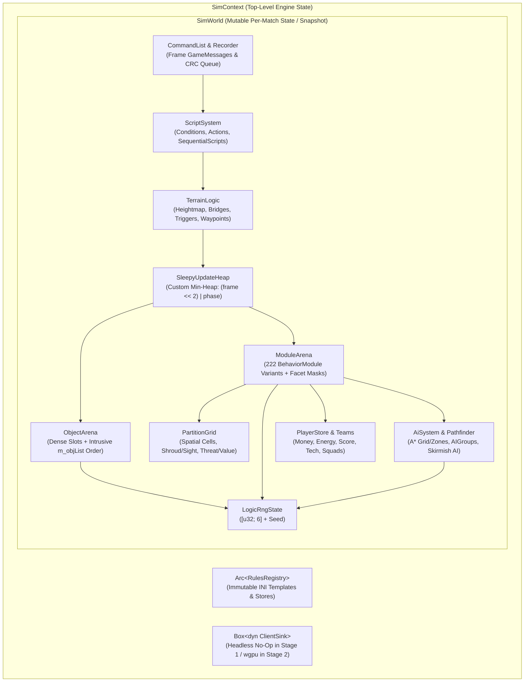
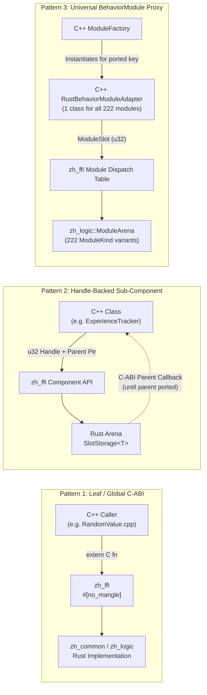

# Architectural & Execution Plan: Zero Hour Engine Port to Rust (`generals-rust`)

> **Goal (owner, 2026-11-27):** the whole game in Rust, with no C++. This plan stops at a headless simulator; the client it does not cover is sized in `docs/OPEN_DECISIONS.md` item 10.

## 1. Objective & Milestones

Port the game engine of *Zero Hour* (~330k lines of C++ across `GameLogic` and `Common` in 871 files) to Rust as a clean, idiomatic, GPL-3.0-or-later public portfolio project, verified bit-exact against real game replays via the engine's built-in per-frame state checksums (`XferCRC`).

- **Stage 1 (Primary Milestone):** Headless Rust simulation that executes real *Zero Hour* replays at 30 logic frames/second (`LOGICFRAMES_PER_SECOND = 30`) and produces the exact same per-frame state checksums (`GameLogic::getCRC`) as the reference C++ build (`fbraz3/GeneralsX` at `84a7a20769aa5749f388b1f49bd542c79b3c33e8`).
- **Stage 2 (Subsequent Milestone):** Native client and renderer (`wgpu`/Metal on macOS Apple Silicon) replacing `GameClient` and `WW3D2`.

---

## 2. Project Identity, Naming & Governance Rules

1. **Repository & Crate Naming (EA GPLv3 Section 7 Compliance):**
   - No `"Command & Conquer"`, `"C&C"`, or `"cnc"` in the repository name, Cargo workspace/crate names, or binary names.
   - **GitHub Repository:** `chayuto/generals-rust` (started **private**; goes public only on owner instruction).
   - **Local Workspace Folder:** `/Users/chayut/repos/generals-rust`.
   - **Cargo Workspace Layout:**
     - `crates/zh_common` — deterministic math (`GameMath` bindings/port), PRNG (`RandomValue`), `CRC` / `XferCRC`, `BitFlags<N>`, `NameKeyTable`, `INI` parsers, `Dict`, coordinate/matrix types (`Coord3D`, `Matrix3D`, `GeometryInfo`).
     - `crates/zh_logic` — `SimContext`, `ObjectArena`, `ModuleArena` (all 222 object modules), `SleepyUpdateHeap`, `PartitionGrid`, `TerrainLogic`, `PlayerStore`, `AiSystem`, `Pathfinder`, `ScriptSystem`, `Weapon`, `Locomotor`.
     - `crates/zh_ffi` — `staticlib` C-ABI strangler bridge (`libzh_ffi.a`) linked into `z_gameengine` during Phases 1–6.
     - `crates/zh_sim` — standalone pure-Rust headless replay runner binary (`zh-sim`) for Stage 1 completion (Phase 7).
2. **License:** `GPL-3.0-or-later` with Electronic Arts Section 7 Additional Terms and an explicit Notice of Modification in `LICENSE.md`.
3. **Complete Independence:** Zero code, crates, submodules, or packages from any other repository owned by the user (`cnc-gen-rig`, `cnc-gen-engine`, `rust-ra2-arena`, `ra2-arena-engine`, `civrig`, `rignarok`).
4. **Zero Game Assets in Git:** `.gitignore` and `.githooks/pre-commit` block `.big`, `.bik`, `.map`, `.wak`, `.tga`, `.dds`, `.w3d`, `.csf`, `.str`, `.mp3`, `.wav`, `.exe`, `.dll`, and archive formats. Only self-recorded `.rep` test replays under `replays/` are permitted in git.
5. **No Upstream Contact:** Zero PRs, issues, or comments to `fbraz3/GeneralsX` or `TheSuperHackers/GeneralsGameCode`.
6. **Commit Hygiene:**
   - Git `user.email` pinned to `5305832+chayuto@users.noreply.github.com`.
   - `.githooks/pre-commit` and `.githooks/commit-msg` active via `git config core.hooksPath .githooks`.
   - Zero co-author trailers, generator notices, session links, or assistant names anywhere in commits, PRs, code, or documentation.
7. **Desktop Courtesy:** All builds and replay checks run strictly headless (`-headless`, `SDL_VIDEODRIVER=dummy`, `SDL_AUDIODRIVER=dummy`). Never focus, resize, or `open` GUI windows.
8. **Continuous Documentation:** Record findings, benchmark timings, and desync root causes into `docs/` and commit before advancing to the next step.

---

## 3. Target Rust Architecture & Domain Model

The original C++ codebase uses ~71 global singletons (`The*`), 352 manual `new`/`delete` calls (plus `MemoryPoolObject` intrusive free-lists), deep multiple-inheritance hierarchies across 222 `BehaviorModule` classes, and cyclic raw pointers (`Object*`, `Team*`, `Player*`, `AIGroup*`, `UpdateModule*`).

Below is the target Rust architecture designed to replace those patterns with safe, deterministic arena ownership while preserving 100% bit-exact execution and CRC order.



### 3.1 Partitioning the ~71 `The*` Singletons into Three Clean Layers

Instead of 71 mutable globals, `SimContext` partitions all engine singletons by lifetime and mutability:

1. **Layer 1: `RulesRegistry` (Immutable After `GameEngine::init()`, Shared via `&RulesRegistry`):**
   - `GlobalData` (`TheGlobalData`)
   - `NameKeyTable` (`TheNameKeyGenerator` — sequential `NameKeyType` interning table; deterministic INI load order preserved)
   - `ScienceStore` (`TheScienceStore`)
   - `MultiplayerSettings` (`TheMultiplayerSettings`)
   - `TerrainTypeCollection` & `TerrainRoadCollection` (`TheTerrainTypes`, `TheTerrainRoads`)
   - `RankInfoStore` (`TheRankInfoStore`)
   - `PlayerTemplateStore` (`ThePlayerTemplateStore`)
   - `WeaponTemplateStore` (`TheWeaponStore` static templates)
   - `ObjectCreationListStore` (`TheObjectCreationListStore`)
   - `LocomotorTemplateStore` (`TheLocomotorStore` static templates)
   - `SpecialPowerStore` (`TheSpecialPowerStore`)
   - `ArmorStore` (`TheArmorStore`)
   - `ThingTemplateStore` (`TheThingFactory` — ~3,000 `ThingTemplate` definitions and their immutable `ModuleData` descriptors)
   - `UpgradeCenter` (`TheUpgradeCenter`)
   - `CrateSystem` (`TheCrateSystem`)
   - `StaticAiData` (`TheAI->getAiData()` static tuning parameters)

2. **Layer 2: `SimWorld` (Mutable Per-Match State, Reset Between Replays, Hashed by `getCRC()`):**
   - `frame: u32`, `game_mode: GameMode`, `crc: u32`, `rank_level_limit: i32`
   - `rng: LogicRngState` (`theGameLogicSeed: [u32; 6]`, `theGameLogicBaseSeed: u32`)
   - `objects: ObjectArena` (`m_objList`, `m_objHash`, `m_objectsToDestroy`, `m_nextObjID`)
   - `modules: ModuleArena` (all live `BehaviorModule` instances owned by objects)
   - `sleepy_updates: SleepyUpdateHeap` (`m_sleepyUpdates` custom binary min-heap)
   - `partition: PartitionGrid` (`ThePartitionManager` + `TheGhostObjectManager`)
   - `terrain: TerrainLogic` (`TheTerrainLogic`, dynamic bridge states, `PolygonTrigger` states, `SidesList`)
   - `players: PlayerStore` (`ThePlayerList`, `Player` instances, `TheTeamFactory`, `Team` instances, `Squad` instances, `TheBuildAssistant`, `TheCaveSystem`, `TheActionManager`)
   - `ai: AiSystem` (`TheAI`, `Pathfinder`, `AIGroup` store + `m_groupList`, `AIPlayer` / `AISkirmishPlayer`)
   - `scripts: ScriptSystem` (`TheScriptEngine`, `TheScriptConditions`, `TheScriptActions`, `TheVictoryConditions`)
   - `recorder: ReplayRecorder` (`TheRecorder`, `TheCommandList`, `TheMessageStream`)

3. **Layer 3: `ClientSink` Trait (Visual/Audio Side-Effects — Zero Logic Mutation):**
   - Wraps `TheGameClient`, `TheDisplay`, `TheInGameUI`, `TheControlBar`, `TheEva`, `TheAudio`, `TheRadar` (visual markers), `TheTacticalView`, `TheParticleSystemManager`, `TheFXListStore`, `TheDamageFXStore`.
   - In Stage 1 headless mode, `HeadlessClientSink` implements these as fast no-ops (except where `GameLogic` queries read-only drawable/bone metadata or `TheRadar` object registration), verified by `-VerifyClientCRC` to confirm zero impact on `GameLogic::getCRC()`.

---

### 3.2 `ObjectArena` & Deterministic Intrusive Lists Without Raw Pointers

`Object` is the central entity in `GameLogic`, participating simultaneously in:
- `GameLogic::m_objList` (intrusive doubly-linked list of all world objects, newest-first)
- `GameLogic::m_objHash` (`ObjectID -> Object*` lookup table)
- `Team::m_teamMemberList` (intrusive doubly-linked list of team members)
- `GameLogic::m_objectsToDestroy` (deferred end-of-frame destruction vector)
- `PartitionCell` / `PartitionData` spatial links

In Rust (`zh_logic`), we model `Object` storage as a generational slot arena (`ObjectArena`) with explicit intrusive link indices:

```rust
#[repr(transparent)]
#[derive(Copy, Clone, Eq, PartialEq, Ord, PartialOrd, Hash, Debug)]
pub struct ObjectId(pub i32); // Matches C++ ObjectID (INVALID_ID = 0)

#[repr(transparent)]
#[derive(Copy, Clone, Eq, PartialEq, Debug)]
pub struct ObjectSlot(pub u32); // Dense index into ObjectArena::slots

pub struct ObjectArena {
    pub slots: Vec<Option<ObjectRecord>>,
    pub free_slots: Vec<u32>,
    pub id_to_slot: BTreeMap<ObjectId, ObjectSlot>, // Deterministic lookup (or flat page table)
    pub world_head: Option<ObjectSlot>,             // Head of m_objList (newest object first)
    pub objects_to_destroy: Vec<ObjectSlot>,        // Deferred destroy queue (m_objectsToDestroy)
    pub next_obj_id: ObjectId,                      // Monotonic counter (m_nextObjID)
}
```

**Preserving Exact `Object` Lifecycle Invariants:**
1. **Prepend-on-Register (`registerObject`):** When an object is created, it is inserted at `world_head` (`new_obj.next_in_world = world_head; world_head = Some(slot)`), matching `obj->prependToList(&m_objList)`.
2. **Deferred Destruction (`destroyObject` -> `processDestroyList`):**
   - `destroy_object(slot)` checks `OBJECT_STATUS_DESTROYED`; if already set, returns immediately.
   - Otherwise, runs `DestroyModuleInterface::on_destroy()` on all matching modules, sets `OBJECT_STATUS_DESTROYED`, clears `AIUpdate` locomotor goals/paths, appends `slot` to `objects_to_destroy`, runs `obj.on_destroy()`, and removes wall pieces from `Pathfinder`.
   - At Step 15a of `GameLogic::update()`, `process_destroy_list()` iterates `objects_to_destroy` in FIFO order (allowing `onDelete` callbacks to push sub-objects to the tail of `objects_to_destroy`), removes the object's `UpdateModule`s from `SleepyUpdateHeap` using the **two-pass reverse-heap-index algorithm** (Section 3.4), unlinks `slot` from `world_head` and `id_to_slot`, and frees the slot.

---

### 3.3 `ModuleArena` & Facet Dispatch: Translating the 222 `BehaviorModule` Classes

In C++, `BehaviorModule` uses multiple inheritance across 10 lifecycle interfaces (`UpdateModuleInterface`, `DieModuleInterface`, `DamageModuleInterface`, `ContainModuleInterface`, `CollideModuleInterface`, `CreateModuleInterface`, `UpgradeModuleInterface`, `SpecialPowerModuleInterface`, `BodyModuleInterface`, `DestroyModuleInterface`) plus 25 specialized sub-interfaces (`AIUpdateInterface`, `ExitInterface`, `DockUpdateInterface`, `ParkingPlaceBehaviorInterface`, `ProjectileUpdateInterface`, `SlavedUpdateInterface`, `ProductionUpdateInterface`, `SpawnBehaviorInterface`, etc.).

In Rust, we eliminate vtable pointer webs and `dynamic_cast`-style hops with a **Two-Level Tagged Module Arena + 64-bit Facet Bitmask**:

```rust
#[repr(transparent)]
#[derive(Copy, Clone, Eq, PartialEq, Debug)]
pub struct ModuleSlot(pub u32);

bitflags::bitflags! {
    #[derive(Copy, Clone, Debug)]
    pub struct FacetMask: u64 {
        // 10 Primary Lifecycle Facets
        const UPDATE        = 1 << 0;
        const DIE           = 1 << 1;
        const DAMAGE        = 1 << 2;
        const CREATE        = 1 << 3;
        const COLLIDE       = 1 << 4;
        const BODY          = 1 << 5;
        const CONTAIN       = 1 << 6;
        const UPGRADE       = 1 << 7;
        const SPECIAL_POWER = 1 << 8;
        const DESTROY       = 1 << 9;

        // 25 Specialized Query Sub-Interfaces
        const AI_UPDATE             = 1 << 10;
        const PHYSICS_BEHAVIOR      = 1 << 11;
        const STEALTH_UPDATE        = 1 << 12;
        const SPY_VISION_UPDATE     = 1 << 13;
        const PROJECTILE_UPDATE     = 1 << 14;
        const EXIT_INTERFACE        = 1 << 15;
        const DOCK_UPDATE           = 1 << 16;
        const RAILED_DOCK_UPDATE    = 1 << 17;
        const SLOW_DEATH_BEHAVIOR   = 1 << 18;
        const SPECIAL_POWER_UPDATE  = 1 << 19;
        const SLAVED_UPDATE         = 1 << 20;
        const PRODUCTION_UPDATE     = 1 << 21;
        const HORDE_UPDATE          = 1 << 22;
        const POWER_PLANT_UPDATE    = 1 << 23;
        const SPAWN_BEHAVIOR        = 1 << 24;
        const COUNTERMEASURES       = 1 << 25;
        const PARKING_PLACE         = 1 << 26;
        const REBUILD_HOLE          = 1 << 27;
        const BRIDGE_BEHAVIOR       = 1 << 28;
        const BRIDGE_TOWER          = 1 << 29;
        const BRIDGE_SCAFFOLD       = 1 << 30;
        const OVERCHARGE_BEHAVIOR   = 1 << 31;
        const TRANSPORT_PASSENGER   = 1 << 32;
        const CAVE_INTERFACE        = 1 << 33;
        const LAND_MINE_INTERFACE   = 1 << 34;
        const EJECT_PILOT_DIE       = 1 << 35;
    }
}

pub struct ModuleRecord {
    pub owner: ObjectSlot,
    pub tag_key: NameKeyType,
    pub template_data_id: ModuleDataId,
    pub facets: FacetMask,
    // SleepyUpdate scheduler fields (valid when facets.contains(FacetMask::UPDATE))
    pub next_call_frame_and_phase: u32,
    pub index_in_logic: i32,
    // Concrete module state
    pub kind: ModuleKind,
}
```

**Why This Design Fits Zero Hour's Object Model:**
1. **Multi-Facet Modules Share State Naturally:** A module like `SlowDeathBehavior` (which implements `UpdateModuleInterface`, `DieModuleInterface`, and `SlowDeathBehaviorInterface`) is a single `ModuleKind::Behavior(BehaviorKind::SlowDeath(SlowDeathState))` record with `facets = UPDATE | DIE | SLOW_DEATH_BEHAVIOR`. Both `ModuleRecord::update(&mut self, ...)` and `ModuleRecord::on_die(&mut self, ...)` dispatch to that same `SlowDeathState` instance!
2. **Exact Helper & Behavior Ordering on `ObjectRecord`:**
   `ObjectRecord` stores `behaviors: SmallVec<[(ModuleSlot, FacetMask); 16]>`, populated in the exact C++ constructor order (up to 8 conditional sleep helpers first: `SMCHelper`, `StatusDamageHelper`, `SubdualDamageHelper`, `RepulsorHelper`, `DefectionHelper`, `WeaponStatusHelper`, `FiringTracker`, `TempWeaponBonusHelper`; followed by INI behavior modules in `ThingTemplate` order), plus cached `Option<ModuleSlot>` fields for `body`, `contain`, `stealth`, `ai`, and `physics`.
3. **Zero-Overhead Facet Iteration:** When `Object::onDie` or `Object::onDamage` iterates `obj.behaviors`, checking `(slot, mask) if mask.contains(FacetMask::DIE)` skips non-matching modules in a single register test without touching `ModuleArena` memory.
4. **No Borrow-Checker Conflicts During Update/Event Callbacks:**
   When module `M` on object `O` executes `update()`, `M` may mutate other objects (e.g. dealing damage to a target) or call methods on `O` itself. To avoid `&mut SimWorld` aliasing panics, `SimWorld` uses the standard **take-and-restore (or index-passed context)** pattern: either the active `ModuleKind` state is temporarily swapped out with a lightweight placeholder while `update(&mut self, ctx: &mut SimWorld, owner: ObjectSlot, mod_slot: ModuleSlot)` runs, or `ModuleRecord` methods take `(world: &mut SimWorld, mod_slot: ModuleSlot)` and read/write fields via indexed arena access.

---

### 3.4 `SleepyUpdateHeap`: 1:1 Port of `GameLogic::m_sleepyUpdates`

As proven in `docs/RESEARCH.md` Section 3.3, `SleepyUpdateHeap` must replicate the exact array-backed min-heap semantics of `GameLogic.cpp:3040-3350`:

```rust
pub struct SleepyUpdateHeap {
    pub heap: Vec<ModuleSlot>,
}
```

With the five mandatory invariants:
1. **Priority Encoding:** `priority = (wake_frame.min(0x3fff_ffff) << 2) | (phase as u32)` where `SleepyUpdatePhase` is `Initial = 0`, `Physics = 1`, `Normal = 2`, `Final = 3`.
2. **Strict `>` Comparator (`is_lower_priority`):** `a_pri > b_pri`. Sifting down (`rebalance_child`) picks the right child `2*i + 2` **only** if `left_pri > right_pri`; when equal, it always picks the left child `2*i + 1`, and stops sifting as soon as `!(parent_pri > child_pri)`.
3. **In-Place Root Reschedule:** At Step 11 of `GameLogic::update()`, after `heap[0]` runs and returns `sleep_len`, update `heap[0]`'s priority to `((now + sleep_len) << 2) | phase` and call `rebalance_sleepy_update(0)` in place (never pop + push).
4. **Already-Awake Wakeup Guard (`awaken_update_module`):** If `now > 0 && mod.next_call_frame() == now && when_to_wake_up == now + 1`, return immediately without modifying `heap`.
5. **Two-Pass Reverse-Heap-Index Erase (`process_destroy_list`):** When destroying `obj`, first scan `heap[0..len]` linearly to collect all `ModuleSlot`s owned by `obj` into a stack buffer `suo[0..num_suo]`; second, iterate `k` from `num_suo - 1` down to `0`, reading `idx = modules[suo[k]].index_in_logic` and calling `erase_sleepy_update(idx)`.

---

## 4. Three FFI Strangler Bridge Patterns (C++ <-> Rust Coexistence)

To port ~330k lines incrementally while keeping `GeneralsXZH -headless -replay` 100% green at every commit, `crates/zh_ffi` uses three structured FFI patterns depending on subsystem granularity:



### 4.1 Pattern 1: Stateless & Global-Singleton C-ABI Replacement (Phases 1–2)
- **Target Subsystems:** `RandomValue`, `CRC`, `XferCRC`, `GameMath` (`gm_*f`), `BitFlags`, `NameKeyGenerator`, `INI` numeric scanners.
- **Mechanism:** The C++ `.cpp` implementation bodies are replaced with 1-line forwarding calls to `extern "C"` functions exported by `libzh_ffi.a` (`zh_random_init`, `zh_get_game_logic_random_value`, `zh_xfer_crc_add`, etc.).
- **Zero Layout Coupling:** Only primitive values (`i32`, `u32`, `f32`, `*const u8`, `usize`) cross the boundary.

### 4.2 Pattern 2: Handle-Backed Component Bridge with Parent Callbacks (Phases 1, 3, 4)
- **Target Subsystems:** Self-contained classes owned by `Object` or `Player` before `Object`/`Player` themselves are moved to Rust (`ExperienceTracker`, `FiringTracker`, `Energy`, `Money`, `ScoreKeeper`, `ArmorSet`, `WeaponSet`, `Locomotor`, `PartitionManager`).
- **Mechanism:**
  - Either the C++ class's `#[repr(C)]` data layout is passed directly by pointer to Rust `extern "C"` methods, **or** the C++ class stores a `u32` Rust arena handle allocated in its constructor and freed in its destructor.
  - Where the Rust component needs to query or notify its unported C++ parent (e.g., `ExperienceTracker::addExperiencePoints` calling `m_parent->getTemplate()->getExperienceRequired(level)` and `m_parent->onVeterancyLevelChanged(...)`), C++ exports thin `extern "C"` accessor functions (`zh_cxx_obj_get_exp_required(obj_ptr, level)`, `zh_cxx_obj_on_veterancy_changed(obj_ptr, old_lvl, new_lvl, feedback)`).
  - Once the parent (`Object` or `Player`) is ported to Rust in Phase 5/6, those `zh_cxx_*` callbacks are deleted.

### 4.3 Pattern 3: Universal `RustBehaviorModuleAdapter` Proxy for the 222 `BehaviorModule` Classes (Phase 5)
- **Architectural Problem:** Writing 222 bespoke C++ wrapper classes for the 222 `BehaviorModule` subclasses would create massive FFI boilerplate and fragile vtable glue.
- **Architectural Solution:** We introduce **one** C++ adapter class in `z_gameengine`, `RustBehaviorModuleAdapter`, which inherits from `UpdateModule` and implements the sibling facet interfaces (`DieModuleInterface`, `DamageModuleInterface`, `CollideModuleInterface`, `ContainModuleInterface`, `CreateModuleInterface`, `UpgradeModuleInterface`, `SpecialPowerModuleInterface`, `BodyModuleInterface`, `DestroyModuleInterface`, and the specialized sub-interfaces).
  - `RustBehaviorModuleAdapter` holds a single `uint32_t m_rustModuleSlot` and a `uint64_t m_facetMask` queried from Rust at construction time.
  - Its facet query methods (`getDie()`, `getDamage()`, `getContain()`, `getCollide()`, `getUpdate()`, etc.) simply test `m_facetMask`:
    ```cpp
    DieModuleInterface* getDie() override {
        return (m_facetMask & FACET_DIE) ? this : nullptr;
    }
    ```
  - Each virtual method (`update()`, `onDie()`, `onDamage()`, `onCollide()`, `crc()`, `xfer()`, `loadPostProcess()`) forwards `(m_rustModuleSlot, args...)` through a single C-ABI entry point in `zh_ffi` (`zh_module_update(slot)`, `zh_module_on_die(slot, damage_info)`, etc.).
  - When `ModuleFactory::newModule` is called for a module name whose Rust port is complete, it calls `zh_module_create(module_kind_id, thing_ptr, module_data_ptr)` and returns a `RustBehaviorModuleAdapter(slot, mask)`.
  - **Result:** Any of the 222 modules can be translated to pure Rust inside `crates/zh_logic` and enabled in `ModuleFactory` with **zero new C++ glue code**! And at the end of Phase 5 when `Object` itself moves into Rust's `ObjectArena`, `RustBehaviorModuleAdapter` is deleted entirely.

---

## 5. Shadow Verification & Automated CRC Desync Triage Architecture

Waiting for a periodic frame-100 replay CRC mismatch to tell us that a newly translated module has a bug makes debugging slow. We pair the replay CRC oracle with two fast-feedback verification layers:

### 5.1 Layer 1: Dual-Execution Shadow Verification (`#[cfg(feature = "shadow-verify")]`)
During initial bring-up of any tricky mathematical or stateful module (e.g. `RandomValue`, `ExperienceTracker`, `Locomotor`, `Weapon`, `PartitionManager`, `Pathfinder`):
- Both the C++ reference implementation and the Rust implementation execute on the exact same inputs during a headless replay run.
- At the end of every call, the FFI bridge compares the Rust return value, mutated struct state, and `GetGameLogicRandomSeedCRC()` against the C++ result.
- If a single bit differs (even on frame 17, 83 frames before the next replay CRC check), `shadow-verify` logs the exact function name, input arguments, C++ output, and Rust output, and aborts immediately.

### 5.2 Layer 2: 5-Marker Frame Bisection Playbook (`GameLogic::getCRC`)
If a full replay check fails with `CRC Mismatch in Frame F (InGame: 0xAAAA != Replay: 0xBBBB)`:
1. Re-run that single replay with:
   `-headless -replay <file> -DebugCRCFromFrame (F-2) -DebugCRCUntilFrame (F+1) -LogObjectCRCs -SaveDebugCRCPerFrame /tmp/crc_rust`
   and compare against the stock C++ baseline output `/tmp/crc_cpp`.
2. Inspect the 5 section checkpoints logged inside `GameLogic::getCRC()` on frame $F$:
   - `CRC after objects for frame F` (`MARKER:Objects` — if this already differs, diff the per-object `CRC of Object <ID> (<TemplateName>)` lines from `-LogObjectCRCs` to identify the exact `ObjectID` and whether `m_privateStatus`, `Matrix3D`, `m_objectUpgradesCompleted`, `ExperienceTracker`, `health`, `m_weaponBonusCondition`, `damageScalar`, or `Weapon` diverged!).
   - `RandomSeed: <seed>` (`GetGameLogicRandomSeedCRC()` — if `MARKER:Objects` matched but `RandomSeed` diverged, an extra or missing `GameLogicRandomValue*` call occurred during frame $F$).
   - `CRC after partition manager for frame F` (`MARKER:ThePartitionManager` — cell shroud/sight/threat/value divergence).
   - `CRC after PlayerList for frame F` (`MARKER:ThePlayerList` — money, energy, score, science, upgrade, or team membership divergence).
   - `CRC after AI pathfinder` / `CRC after AI for frame F` (`MARKER:TheAI` — pathfinder grid or `AIGroup` state divergence).

---

## 6. In-Depth Phased Execution Roadmap & Work-Package Breakdown

### 5.3 Token Optimization: Tier 0 Context Slicer & 4-Tier Agent Routing
Full operational specification: [docs/AGENT_WORKFLOW_AND_CI.md](docs/AGENT_WORKFLOW_AND_CI.md).

1. **Tier 0 Deterministic Context Slicer (`scripts/prep_packet.py`, 0 LLM Tokens):**
   - Uses `compile_commands.json` (`clang++ -Xclang -ast-dump=json`) to extract a self-contained **3.5–4.5k token Translation Packet** per module (`target.h` + `target.cpp` stripped of license/includes, AST-sliced dependency signatures, mechanically generated `ModuleData` INI field parse table + `Snapshot::crc`/`xfer` skeleton, and a 1-page `RUST_CONVENTIONS_CHEATSHEET.md`).
   - Eliminates multi-turn codebase grepping and repeated reads of 40 KB headers (`Object.h`, `GameLogic.h`, `ThingTemplate.h`), reducing per-module input token consumption by **~88%**.
2. **4-Tier Complexity Routing Across All 871 Files (~330k LOC):**
   - **Class C1 (~35% LOC, ~310 files) -> Tier 1A (Fastest/Lite Model, Single-Turn Zero-Search Sandbox):** Leaf trackers (`RandomValue`, `crc`, `Money`, `Energy`, `ScoreKeeper`, `Armor`, `ExperienceTracker`, `FiringTracker`), 28 `INI` scanners, and simple module categories (`Destroy` [1], `Damage` [3], `Create` [8], `Helper` [8], `Die` [12], `Upgrade` [21], `SpecialPower` [11], `Collide` [20], simple `Body` [6]).
   - **Class C2 (~40% LOC, ~380 files) -> Tier 1B (Fast Model, Single-Turn + 1 Compiler Retry):** ~60 standard `Object/Update/*` modules, ~22 standard `Object/Behavior/*` modules, `ActiveBody`, `StructureBody`, `CrateSystem`, `CaveSystem`, `SidesList`, `PolygonTrigger`, `VictoryConditions`.
   - **Class C3 (~18% LOC, ~130 files) -> Tier 2 (Mid-Tier Engineer Model with `Gate V1/V2` Loop):** `Object/Contain/*` (13), multi-facet `Object/Behavior/*` (8: `Bridge`, `ParkingPlace`, `PropagandaTower`, `RebuildHole`, `SlowDeath`, `Spawn`, etc.), complex `Object/Update/*` (26: `PhysicsUpdate`, `MissileAIUpdate`, `LaserUpdate`, `JetAIUpdate`, `ChinookAIUpdate`, `SupplyTruckAIUpdate`, `WorkerAIUpdate`, `ProductionUpdate`), `Weapon`, `Locomotor`, `TurretAI`, `ScriptConditions` (10 packets), `ScriptActions` (15 packets).
   - **Class C4 (~7% LOC, ~51 files) -> Tier 3 (Lead Architect / Frontier Model):** `SimContext`, `ObjectArena`, `ModuleArena`, `SleepyUpdateHeap`, `RustBehaviorModuleAdapter`, `Object.cpp`, `PartitionManager.cpp`, `TerrainLogic.cpp`, `Pathfinder`, `AI`/`AIGroup`/`AIPlayer`/`AIUpdate`/`AIStateMachine`, `Player`/`Team`, `GameLogic.cpp`, `Recorder.cpp`, plus any `Gate V2/V3/V4` desync escalations.

### 5.4 Compartmentalization & The 4-Gate Automated V&V Funnel
1. **Strict File Isolation:** Each of the 222 `BehaviorModule` classes lives in its own isolated file (`crates/zh_logic/src/modules/<category>/<mod>.rs`). Worker agents can only write to their assigned module file against pre-locked `SimWorld` trait signatures — enabling 5–10 parallel workers with zero merge conflicts. Mega-files (`ScriptConditions.cpp` 170 KB, `ScriptActions.cpp` 270 KB, `GameLogic.cpp` 180 KB) are sliced into 15–20 KB function-group files.
2. **4-Gate Automated Verification Funnel:**
   - **Gate V1 (< 1s, 0 tokens):** `scripts/lint_determinism.py` rejects `HashMap`/`HashSet`/`BinaryHeap`, std `f32` transcendentals (`sin`/`cos`/`sqrt`/`floor`/`ceil`/`atan2`/`mul_add`), pointer ordering, and `usize` serialization + `cargo check`.
   - **Gate V2 (~2s, zero `.big` files needed):** In-process C++-vs-Rust Differential Micro-Harness instantiates the C++ class and Rust struct side-by-side via `libzh_ffi.a`, runs 1,000 seeded fuzz & edge-case steps, and asserts bit-exact equality on return values, `XferSave` snapshot bytes, `XferCRC`, and `GetGameLogicRandomSeedCRC()`.
   - **Gate V3 (~15s):** Lockstep `shadow-verify` smoke replay (`macos_2p_vanilla_map.rep`) comparing C++ and Rust on every live frame call.
   - **Gate V4 (~45s in CI):** Full 6-replay cross-platform headless matrix (`exit 0`, zero CRC mismatches).

### 5.5 Free GitHub Actions Public-Repo CI Offload & Environment Classification (`env:local-full` vs. `env:ephemeral-web`)
- **Public Repo Free Tier:** `chayuto/generals-rust` is **public**, unlocking **unlimited free GitHub Actions minutes** on `macos-15` (Apple Silicon `arm64`) and `ubuntu-latest` (`x86_64`) with up to 20 parallel jobs.
- **Two-Dimensional Task Classification (Model Tier $\times$ Environment Access):**
  - **`env:local-full` (Full Local Workstation Agent):** Has access to `~/Games/generalszh` retail `.big` archives and the local `vendor/GeneralsX` C++ build (`GeneralsXZH`, `compile_commands.json`). Responsible for Phase 0 setup (`WP-0.1..0.4`), C++ FFI seam bring-up (`WP-1.1`, `WP-5.0`), running `scripts/prep_packet.py` to commit self-contained translation packets (`packets/<phase>/<module>.md`) + **1,000-seed C++-recorded Golden Test Vectors (`tests/golden/`)**, and verifying retail `.big`/`.map` readers (`WP-2.4`, `WP-7.2`, `WP-7.3`).
  - **`env:ephemeral-web` (Ephemeral Web / Cloud Sandbox Agent — Codebase-Only Access):** Has access **only** to the `chayuto/generals-rust` git repository (no local `~/Games/generalszh` `.big` files and no local `vendor/GeneralsX` C++ binary). Claims prepared `env:ephemeral-web` packets (~85% of the project: 295+ of 337 packets), translates from the committed `packets/<phase>/<module>.md` slice, verifies **Gate V1** (`scripts/lint_determinism.py` + `cargo check`) and **Gate V2-Golden** (`cargo test` against committed C++ Golden Vectors) locally in-container, and pushes to trigger **Gate V2-FFI / Gate V3 / Gate V4** on public GitHub Actions CI.
  - **`env:hybrid-ci`:** Multi-packet work packages where `env:local-full` seeds the FFI seam + Golden Vectors first, unlocking parallel `env:ephemeral-web` execution for all child packets.

---

## 6. In-Depth Phased Execution Roadmap & Work-Package Breakdown

### Phase 0: Ground Truth & Replay Corpus (C++ Baseline)
**Goal:** Build unmodified `fbraz3/GeneralsX` at commit `84a7a20769aa5749f388b1f49bd542c79b3c33e8`, assemble the verification corpus, and configure local + GitHub Actions CI harnesses.

| Work Package | Tier / Class | Env Access | Scope & Tasks | Gate / Deliverable |
|---|---|---|---|---|
| **WP-0.1: Disk Budget & Retail Game Data (`steamcmd`)** | Tier 3 (`C4`) | `env:local-full` | Verify free disk space. Download Steam App `2732960` into `~/Games/generalszh` via interactive `steamcmd +@sSteamCmdForcePlatformType windows +force_install_dir ~/Games/generalszh +login <user> +app_update 2732960 validate +quit`. Never copy `.big` archives; pass `-assetPath ~/Games/generalszh` (`CNC_GENERALS_ZH_PATH`). | `~/Games/generalszh/*.big` readable in place. |
| **WP-0.2: Reference C++ Build (`GeneralsXZH`)** | Tier 3 (`C4`) | `env:local-full` | Shallow-clone `fbraz3/GeneralsX` at `84a7a20769aa5749f388b1f49bd542c79b3c33e8` into ignored `vendor/GeneralsX`. Configure preset `macos-vulkan` with `-DRTS_BUILD_OPTION_DEBUG=OFF -DRTS_BUILD_GENERALS=OFF -DRTS_BUILD_CORE_TOOLS=OFF` and build target `z_generals` (`GeneralsXZH`). | `GeneralsXZH` `arm64` binary builds cleanly. |
| **WP-0.3: Replay Corpus Assembly** | Tier 3 (`C4`) | `env:local-full` | Install `generalsx-project/GeneralsXReplays` (6 cross-platform Zero Hour replays + custom maps) into `~/Library/Application Support/GeneralsX/GeneralsZH/`. Record additional local skirmish replays into `replays/`. Characterize `TheSuperHackers/GeneralsReplays` under `-ignoreReplaySyncErrors`. | Corpus installed and indexed. |
| **WP-0.4: Verification Harness & CI Workflows** | Tier 3 (`C4`) | `env:local-full` | Write `scripts/check_replays.sh`, `scripts/lint_determinism.py` (`Gate V1`), `scripts/prep_packet.py` (`Tier 0` context slicer + Golden Vector generator), and `.github/workflows/{ci-fast-verify,ci-replay-matrix}.yml`. Record baseline timings and frame counts in `docs/BASELINE.md`. | **Gate 0:** 100% pass (`exit 0`, zero CRC mismatches) on stock C++. |

---

### Phase 1: Translation Spike (Go / No-Go Gate)
**Goal:** Validate the Tier 0 Context Slicer, Tier 1A cheap-model translation workflow, `Gate V1–V4` funnel, and FFI build integration on two real modules (`RandomValue` + `CRC` and `ExperienceTracker`).

| Work Package | Tier / Class | Env Access | Packets | Scope & Tasks | Gate / Deliverable |
|---|---|---|---:|---|---|
| **WP-1.1: Workspace, FFI Seam & Golden Vectors** | Tier 3 (`C4`) | `env:local-full` | 1 | Create Cargo workspace (`crates/zh_common`, `crates/zh_logic`, `crates/zh_ffi`) compiling `libzh_ffi.a`. Link `libzh_ffi.a` into `z_gameengine`. Generate `packets/phase1/*.md` + 1,000-seed C++ Golden Vectors for `RandomValue` and `ExperienceTracker`. | Hybrid C++/Rust `GeneralsXZH` links and passes Gate 0; Golden Vectors committed. |
| **WP-1.2: Autonomous Translation of `RandomValue` + `CRC` & `ExperienceTracker`** | Tier 1A (`C1`) | `env:ephemeral-web` | 2 | Dispatch `packets/phase1/random_value.md` (`#9`) and `packets/phase1/experience_tracker.md` (`#10`) to **Tier 1A (`env:ephemeral-web`)** in zero-search mode. Verify locally against Golden Vectors (`Gate V1` + `Gate V2-Golden`) and in CI (`Gate V2-FFI` + `Gate V3/V4`). | Both modules compiled into `libzh_ffi.a` and passing Gates V1–V4. |
| **WP-1.3: Spike V&V (`Gates V1–V4`) & Telemetry Report** | Tier 3 (`C4`) | `env:local-full` / `env:hybrid-ci` | 1 | Record exact input/output tokens, first-pass accuracy, and any fixes in `docs/PHASE1_SPIKE_REPORT.md`. | **Gate 1 (Owner Go/No-Go):** All replays green; owner reviews `docs/PHASE1_SPIKE_REPORT.md`. |

---

### Phase 2: Foundation, Math & Serialization (`Common` Layer, ~40k LOC)
**Goal:** Move the core deterministic primitives, serialization backbone, and INI scanners into `crates/zh_common` (Pattern 1 FFI).

| Work Package | Tier / Class | Env Access | Packets | Files & Subsystems | Approx. LOC | Verification Gate |
|---|---|---|---:|---|---:|---|
| **WP-2.1: Checksums, BitFlags & Xfer** | Tier 1A (`C1`) + Tier 3 (`Snapshot`) | `env:ephemeral-web` | 4 | `Xfer.cpp`, `XferCRC.cpp`, `XferDeepCRC`, `BitFlags.h`/`BitFlags.cpp` (`BitFlags<128>`), `Snapshot` trait. | ~6,500 | `Gate V1` + `Gate V2` (`XferCRC` byte/word parity) + `Gate V4`. |
| **WP-2.2: Deterministic Math & Geometry** | Tier 1B (`C2`) | `env:ephemeral-web` | 6 | `TheSuperHackers/GameMath` (`gm_*f`), `Coord2D/3D`, `ICoord2D/3D`, `Region2D/3D`, `Matrix3D`, `Vector3`, `GeometryInfo`, `BezierSegment`, `DiscreteCircle`, `PartitionSolver`. | ~11,000 | `Gate V2` (100k-input bit-parity fuzz test vs C++ `GameMath` & `Matrix3D`) + `Gate V4`. |
| **WP-2.3: NameKeys, Strings, Dict & StateMachine** | Tier 1B (`C2`) | `env:ephemeral-web` | 4 | `NameKeyGenerator.cpp`, `AsciiString` / `UnicodeString` FFI views, `Dict.cpp`, `StateMachine.cpp`. | ~9,500 | `Gate V2` + verify exact `NameKeyType` IDs after `GameEngine::init()` + `Gate V4`. |
| **WP-2.4: INI Parser & Numeric Scanners** | Tier 1A (`C1`) | `env:ephemeral-web` (28 scanners) + `env:local-full` (`INI.big` CRC) | 10 | `Core/GameEngine/Source/Common/INI/*` (28 files: tokenizers, `from_chars` numeric scanners, `scanPercentToReal`, `scanIndexList`, `BitFlagsIO`, `MultiIniFieldParse`). | ~13,000 | `Gate V2` + verify `TheGlobalData->m_iniCRC` matches C++ bit-exact + `Gate V4`. |

---

### Phase 3: Core RTS Domain Models & Leaf Trackers (~35k LOC)
**Goal:** Port self-contained gameplay value trackers and template stores into `crates/zh_logic` (Pattern 2 FFI).

| Work Package | Tier / Class | Env Access | Packets | Files & Subsystems | Approx. LOC | Verification Gate |
|---|---|---|---:|---|---:|---|
| **WP-3.1: Economy & Player Leaf Trackers** | Tier 1A (`C1`) | `env:ephemeral-web` | 6 | `Money.cpp`, `Energy.cpp`, `ScoreKeeper.cpp`, `Handicap.cpp`, `MissionStats.cpp`, `AcademyStats.cpp`. | ~8,000 | `Gate V1–V4` (`MARKER:ThePlayerList` CRCs bit-exact). |
| **WP-3.2: Tech Tree, Upgrades & Special Powers** | Tier 1A (`C1`) | `env:ephemeral-web` | 7 | `Science.cpp`, `RankInfo.cpp`, `Upgrade.cpp`, `SpecialPower.cpp`, `ProductionPrerequisite.cpp`, `PlayerTemplate.cpp`, `MultiplayerSettings.cpp`. | ~11,500 | `Gate V1–V4`. |
| **WP-3.3: Combat & Locomotion Leaf Models** | Tier 1A + Tier 2 | `env:ephemeral-web` | 8 | `Armor.cpp`, `Damage.cpp`, `FiringTracker.cpp`, `TurretAI.cpp`, `Locomotor.cpp` & `LocomotorSet.cpp`. | ~15,500 | `Gate V2` + `Gate V3` (`shadow-verify` `Locomotor` trajectories) + `Gate V4`. |

---

### Phase 4: Spatial & World Subsystems (~30k LOC)
**Goal:** Port map geometry, triggers, and the spatial partition grid (`MARKER:ThePartitionManager` in `GameLogic::getCRC`).

| Work Package | Tier / Class | Env Access | Packets | Files & Subsystems | Approx. LOC | Verification Gate |
|---|---|---|---:|---|---:|---|
| **WP-4.1: TerrainLogic, Triggers & Map Metadata** | Tier 3 + Tier 1B | `env:hybrid-ci` | 6 | `TerrainLogic.cpp`, `PolygonTrigger.cpp`, `SidesList.cpp`, `CrateSystem.cpp`, `CaveSystem.cpp`. | ~11,000 | `Gate V2–V4`. |
| **WP-4.2: PartitionManager, Shroud/Sight & GhostObject** | Tier 3 (`C4`) | `env:hybrid-ci` | 6 | `PartitionManager.cpp` (`PartitionCell`, `PartitionData`, `SightingInfo`, `PartitionManager::crc`), `SimpleObjectIterator.cpp`, `GhostObject.cpp`. | ~19,000 | `Gate V2–V4` (`MARKER:ThePartitionManager` CRCs bit-exact). |

---

### Phase 5: `Object`, `Weapon`, and the 222 `BehaviorModule` Classes (~135k LOC)
**Goal:** Deploy the Universal `RustBehaviorModuleAdapter` proxy (Pattern 3 FFI) on `env:local-full` and fan out across **`env:ephemeral-web` Tier 1A/1B/2 worker agents** to strangle all 222 object modules into `crates/zh_logic`.

| Work Package | Tier / Class | Env Access | Packets | Files & Subsystems | Approx. LOC | Verification Gate |
|---|---|---|---:|---|---:|---|
| **WP-5.0: `ModuleArena` & Universal `RustBehaviorModuleAdapter`** | Tier 3 (`C4`) | `env:local-full` | 1 | Build `ModuleArena`, `FacetMask`, and C++ `RustBehaviorModuleAdapter` in `z_gameengine` + `ModuleFactory` hook + Golden Vector dumper for all 222 modules. | ~2,500 | Adapter verified with canary module; `Gate V4` green. |
| **WP-5.1: Helpers, Destroy, Damage, Create & Body (28 files)** | Tier 1A + Tier 1B | `env:ephemeral-web` | 28 | `Object/Helper/*` (8), `Object/Destroy/*` (1), `Object/Damage/*` (3), `Object/Create/*` (8), `Object/Body/*` (8). | ~13,500 | `Gate V1–V4` (`Object::crc` health/damageScalar bit-exact). |
| **WP-5.2: Die, SpecialPower, Upgrade & Collide (64 files)** | Tier 1A (`C1`) | `env:ephemeral-web` | 64 | `Object/Die/*` (12), `Object/SpecialPower/*` (11), `Object/Upgrade/*` (21), `Object/Collide/*` (20). | ~26,000 | `Gate V1–V4`. |
| **WP-5.3: Contain & Behavior Modules (43 files)** | Tier 1B (22) + Tier 2 (21) | `env:ephemeral-web` | 43 | `Object/Contain/*` (13), `Object/Behavior/*` (30). | ~42,000 | `Gate V1–V4`. |
| **WP-5.4a–5.4e: All 86 Update Modules (5 Sub-Batches)** | Tier 1B (60) + Tier 2 (25) + Tier 3 (`AIUpdate`) | `env:ephemeral-web` | 86 | `Object/Update/*` (86 files across 5 sub-batches of ~17 files each). | ~75,000 | `Gate V1–V4` after each sub-batch. |
| **WP-5.5: `Weapon`, `WeaponSet`, `ObjectCreationList` & `Object` Core** | Tier 2 + Tier 3 | `env:hybrid-ci` | 8 | `Weapon.cpp`, `WeaponSet.cpp`, `ObjectCreationList.cpp`, `Object.cpp` (`ObjectArena`, `Object::crc`). | ~26,000 | `Gate V1–V4` (`MARKER:Objects` CRCs 100% computed by Rust). |

---

### Phase 6: `Player`, `Team`, `Pathfinder`, `AI`, and `ScriptEngine` (~70k LOC)
**Goal:** Port player management, A* pathfinding, tactical/skirmish AI, and map scripting (`MARKER:ThePlayerList` and `MARKER:TheAI` in `GameLogic::getCRC`).

| Work Package | Tier / Class | Env Access | Packets | Files & Subsystems | Approx. LOC | Verification Gate |
|---|---|---|---:|---|---:|---|
| **WP-6.1: `Player`, `PlayerList`, `Team`, `Squad` & `BuildAssistant`** | Tier 3 + Tier 1B | `env:hybrid-ci` / `env:ephemeral-web` | 9 | `Player.cpp`, `PlayerList.cpp`, `Team.cpp`, `Squad.cpp`, `BuildAssistant.cpp`, `ResourceGatheringManager.cpp`, `ActionManager.cpp`. | ~18,500 | `Gate V1–V4` (`MARKER:ThePlayerList` CRCs 100% computed by Rust). |
| **WP-6.2: `Pathfinder` (`Core` + `GeneralsMD`)** | Tier 3 (`C4`) | `env:hybrid-ci` | 11 | `Core/GameEngine/Source/GameLogic/AI/Pathfind*.cpp` (10) + `GeneralsMD/.../AIPathfind.cpp`. | ~16,500 | `Gate V2–V4` (`CRC after AI pathfinder` bit-exact). |
| **WP-6.3: `AI`, `AIGroup`, `AIPlayer`, `AISkirmishPlayer` & `AIStateMachine`** | Tier 3 (`C4`) | `env:hybrid-ci` | 8 | `AI.cpp`, `AIGroup.cpp`, `AIPlayer.cpp`, `AISkirmishPlayer.cpp`, `AIStateMachine.cpp`, `AIStates.cpp`, `AITNGuard.cpp`. | ~18,000 | `Gate V2–V4` (`MARKER:TheAI` CRCs 100% computed by Rust). |
| **WP-6.4: `ScriptEngine`, `ScriptConditions` (10), `ScriptActions` (15) & `VictoryConditions`** | Tier 3 (2) + Tier 2 (25) + Tier 1B (2) | `env:ephemeral-web` | 29 | `Scripts.cpp`, `ScriptEngine.cpp`, `ScriptConditions.cpp` (10 packets), `ScriptActions.cpp` (15 packets), `SequentialScript.cpp`, `VictoryConditions.cpp`. | ~22,000 | `Gate V1–V4` (map scripts execute 100% in Rust). |

---

### Phase 7: Top-Level `GameLogic` Loop & Standalone Stage 1 Milestone (~20k LOC)
**Goal:** Port `GameLogic.cpp` (`SleepyUpdateHeap`, `processCommandList`, `getCRC`), `Recorder.cpp` (`.rep` parser & CRC verifier), `ArchiveFileSystem` (`.big` reader), and `MapReader` so the simulation runs as a standalone 100% pure-Rust executable (`zh-sim`) with zero C++ linked.

| Work Package | Tier / Class | Env Access | Packets | Files & Subsystems | Approx. LOC | Verification Gate |
|---|---|---|---:|---|---:|---|
| **WP-7.1: `GameLogic` Frame Scheduler & Command Dispatcher** | Tier 3 (4) + Tier 2 (4) | `env:hybrid-ci` | 8 | `GameLogic.cpp`: `SleepyUpdateHeap` (`m_sleepyUpdates`), 55 `on*` command handlers, `startNewGame`, `processDestroyList`, `GameLogic::update()`, `GameLogic::getCRC()`. | ~9,500 | Entire 16-step `GameLogic::update()` runs in Rust inside `GeneralsXZH`. |
| **WP-7.2: Pure-Rust `.big`, `.map`, `.csf` & `.rep` Readers** | Tier 2 (`C3`) | `env:local-full` / `env:hybrid-ci` | 5 | `ArchiveFileSystem` / `BIGFileSystem`, `DataChunk.cpp`, `MapObject.cpp`, `Recorder.cpp`. | ~7,500 | Standalone Rust readers parse retail `.big`, `.map`, and `.rep` files identically to C++. |
| **WP-7.3: Standalone `zh-sim` Binary & Stage 1 Benchmark** | Tier 3 (`C4`) | `env:local-full` | 2 | Wire `crates/zh_sim` (`zh-sim -headless -replay <glob> -jobs N`). Run the entire replay corpus in 100% pure Rust with zero C++ linked. | ~3,000 | **Stage 1 Milestone Complete:** 100% bit-exact replay parity in standalone pure Rust. |

---

### Stage 2 (Future): Native Client & `wgpu`/Metal Renderer
Once Stage 1 is complete and signed off:
- Implement `WgpuClientSink` in `crates/zh_client` using `wgpu` (Metal backend on macOS Apple Silicon): `.w3d` hierarchical mesh/bone/animation loader, `.dds`/`.tga` texture pipeline, terrain heightmap/road/water renderer, particle system, `.wnd` UI layout engine, and MiniAudio/cpal audio output driving `SimContext` at 30 Hz logic / unlocked render framerate.

---

## 7. Repository & Shared Workspace Status

- **Public GitHub Repository:** `https://github.com/chayuto/generals-rust` (`visibility: PUBLIC`)
- **GitHub Discussions:** Enabled (`#1` Constitution & Architecture, `#2` Multi-Agent Coordination & 2D Task Routing Protocol, `#3` Phase 0 & Phase 1 Execution Board)
- **GitHub Milestones & Issues:** 8 Phase Milestones (`Phase 0`..`Phase 7`), 23 labels (`phase:*`, `tier:*`, `env:local-full`, `env:ephemeral-web`, `env:hybrid-ci`, `status:*`, `type:*`), and 30 seeded Work Package & Packet Issues (`#4`–`#33`).
- **Local Bootstrap & V&V Self-Tests:** `./scripts/bootstrap_repo.sh` and `python3 scripts/test_lint_determinism.py` passing.
