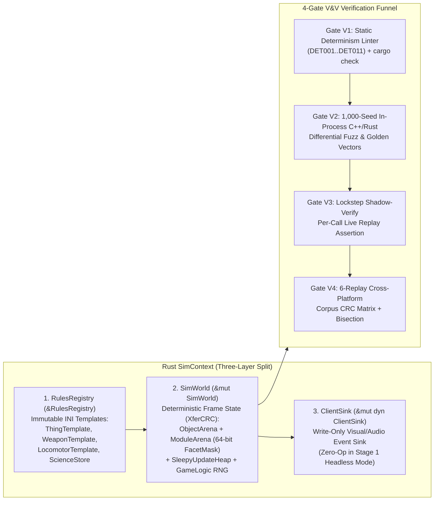

# `generals-rust`

[](https://github.com/chayuto/generals-rust/actions/workflows/ci-guardrails.yml)
[](LICENSE.md)
[](docs/CPP_TO_RUST_PORTING_PLAYBOOK.md)

**`generals-rust`** is an incremental, bit-exact Rust port of the 30 Hz deterministic simulation engine (`GameLogic` and `Common`) from *Command & Conquer: Generals – Zero Hour* (SAGE engine), verified frame-for-frame against real game replays across **macOS (`aarch64`)**, **Linux (`x86_64` / `aarch64`)**, and **Windows (`x86_64`)**.

> [!IMPORTANT]
> **Non-Official Community Project & Zero Proprietary Assets Policy**
> - This project is an independent open-source engineering effort and is **not** affiliated with, endorsed by, or sponsored by Electronic Arts Inc.
> - **No proprietary game data or retail assets** (`.big`, `.map`, `.w3d`, `.tga`, `.dds`, `.bik`, `.csf`, audio, or executables) are included in or accepted by this repository. Running full game replays requires a legally acquired retail installation of *Command & Conquer: Generals – Zero Hour* (e.g., Steam App `2732960` or EA App) mounted externally via `-assetPath`.
> - Distributed under the **GNU General Public License v3.0 or later** with **Electronic Arts Section 7 Additional Terms**; see [LICENSE.md](LICENSE.md) for full terms and the Notice of Modification.

---

## 1. Project Goals & Two-Stage Roadmap

The SAGE engine in *Zero Hour* contains ~330,000 lines of C++ across `GameLogic` and `Common` (`833` source/header files mapped into `463` atomic translation packets). Unlike a ground-up rewrite that approximates gameplay mechanics, `generals-rust` uses the engine's built-in multiplayer lockstep checksum pipeline (`XferCRC` / `GameLogic::getCRC()`) as a **mathematical verification oracle**:

1. **Stage 1 — Bit-Exact Headless Simulation (`Phase 0` – `Phase 7`, [docs/STAGE1_COMPLETION_PLAN.md](docs/STAGE1_COMPLETION_PLAN.md)):**
   - Incrementally replace C++ subsystems in `GameLogic` and `Common` with idiomatic, deterministic Rust crates (`zh_common`, `zh_logic`, `zh_sim`, `zh_ffi`) using a **Strangler-Fig C-ABI FFI bridge** against the cross-platform reference build (`fbraz3/GeneralsX` at pinned commit `84a7a20769aa5749f388b1f49bd542c79b3c33e8`).
   - Run headless replays at 30 logic frames per second (`LOGICFRAMES_PER_SECOND = 30`) and match the C++ reference engine's per-frame `GameLogic::getCRC()` bit-for-bit across all replay frames.
2. **Stages 2–6 — Pure-Rust Assets, Native Renderer, UI, A/V & Multiplayer ([docs/FULL_PORT_PLAN.md](docs/FULL_PORT_PLAN.md), [docs/CLIENT_ARCHITECTURE_PLAN.md](docs/CLIENT_ARCHITECTURE_PLAN.md)):**
   - Expand `zh_assets` and build a zero-external-crate `zh_client_core` + `zh_net` alongside `wgpu` rendering (`zh_render`), `cpal`/`symphonia` audio (`zh_audio`), Bink `.bik` video (`zh_video`), and `winit` shell (`zh_app`) until the entire game runs cleanly in Rust with zero C++.

---

## 2. Architecture & Verification Highlights



### Key Technical Pillars
- **Borrow-Split Generational Arenas (`ObjectArena` & `ModuleArena`):** Replaces C++ deep inheritance hierarchies (`Object` + 222 `BehaviorModule` subclasses with diamond virtual inheritance) with cache-friendly generational handles, a 64-bit `FacetMask` replacing dynamic `dynamic_cast` / vtable queries, and a `Take-and-Restore` dispatch protocol (`SimWorld::with_module_dispatch`) that safely supports deep re-entrant damage/death/spawn callbacks without `RefCell` or `unsafe` aliasing.
- **Bit-Exact `SleepyUpdateHeap` & Determinism Rules:** Preserves the exact `(wake_frame.min(0x3fff_ffff) << 2) | phase` priority key, strict `>` comparator with left-child tie-breaking, in-place root sifting, and reverse-heap-index destruction order from `GameLogic.cpp`.
- **Cross-Platform Determinism Enforcement (`Gate V1`):** Static linter (`scripts/lint_determinism.py`) rejects `HashMap`/`HashSet`, `std::collections::BinaryHeap`, standard library `f32` transcendentals, fused multiply-add (`mul_add`), pointer-keyed maps, platform-sized `usize`/`c_long`/`c_char` in serialized or FFI code, and locale-sensitive float parsing.
- **3-Pattern FFI Strangler Seam & Runtime Desync Bisection:** Supports leaf function replacement (`Pattern 1`), opaque Rust-owned sub-structs (`Pattern 2`), and per-class `RustBehaviorModuleAdapter` swaps (`Pattern 3`) with runtime `ZH_RUST_BYPASS_MODULES` bisection to isolate any CRC divergence in $O(\log N)$ steps without recompiling.

---

## 3. Repository Map & Documentation

| Document / Path | Description |
| :--- | :--- |
| **[PLAN.md](PLAN.md)** | Stage 1 architectural blueprint, 3-layer `SimContext` design, FFI strangler patterns, and Work Packages `WP-0.1`..`WP-7.3`. |
| **[docs/FULL_PORT_PLAN.md](docs/FULL_PORT_PLAN.md)** | Master 6-stage architecture, verified codebase census, full-game workspace map, risk register, and owner decision gates. |
| **[docs/STAGE1_COMPLETION_PLAN.md](docs/STAGE1_COMPLETION_PLAN.md)** | Slice-by-slice engineering plan (`L1`–`L12`) from current simulation state to standalone headless replay CRC parity (`zh-sim`). |
| **[docs/CLIENT_ARCHITECTURE_PLAN.md](docs/CLIENT_ARCHITECTURE_PLAN.md)** | Stages 2–6 architecture (`zh_assets`, `zh_client_core`, `zh_render`, `zh_audio`, `zh_video`, `zh_net`, `zh_app`), logic-client boundary, and proposed external crate table. |
| **[docs/MULTI_AGENT_ROADMAP.md](docs/MULTI_AGENT_ROADMAP.md)** | End-to-end multi-agent task dependency DAG (`Blocked By` $\rightarrow$ `Unblocks`), 6 master unblockers, parallel swarm fan-out windows, and Milestones `M0`–`M7`. |
| **[AGENTS.md](AGENTS.md)** | Contributors & multi-agent constitution, V&V Golden Rule (*"Never build something you cannot verify"*), 2D task classification (`tier:*` $\times$ `env:*`), and GitHub Issue claiming protocol. |
| **[docs/ARCHITECTURE_SPEC.md](docs/ARCHITECTURE_SPEC.md)** | Frozen Rust & C-ABI (`zh_ffi.h`) interface contracts for `SimWorld::with_module_dispatch`, `Pattern 1–3` FFI bridges, and the Gate V2 Golden-Vector JSON schema. |
| **[docs/RESEARCH.md](docs/RESEARCH.md)** | Technical reference for `fbraz3/GeneralsX` at `84a7a20` (48-singleton init sequence, 16-step `GameLogic::update()` loop, `m_sleepyUpdates` heap rules, and `XferCRC` pipeline). |
| **[docs/CPP_TO_RUST_PORTING_PLAYBOOK.md](docs/CPP_TO_RUST_PORTING_PLAYBOOK.md)** | Cross-platform ABI matrix (Windows LLP64 vs. Linux/macOS LP64, `aarch64` unsigned `char`, case-sensitive Linux VFS, floating-point rules) and industry C++-to-Rust porting lessons. |
| **[docs/RUST_CONVENTIONS.md](docs/RUST_CONVENTIONS.md)** | Mandatory 10-rule C++-to-Rust determinism translation guide and embedded worker cheat sheet. |
| **[docs/AGENT_WORKFLOW_AND_CI.md](docs/AGENT_WORKFLOW_AND_CI.md)** | Tier 0 AST context slicer (~88% token reduction), 4-Tier routing matrix, 4-Gate V&V funnel, and zero-cost two-tier GitHub Actions CI architecture. |
| **[docs/MODULE_MANIFEST.md](docs/MODULE_MANIFEST.md)** & **[docs/MODULE_MANIFEST.json](docs/MODULE_MANIFEST.json)** | Complete file-coverage manifest mapping all `833` C++ files (`11.46 MB`) into `463` atomic translation packets (`PKT-001`..`PKT-463`). |
| **[packets/phase1/](packets/phase1/)** | Self-contained Phase 1 translation packets (`PKT-001_crc.md`, `PKT-002_RandomValue.md`, `PKT-003_ExperienceTracker.md`). |
| **[LICENSE.md](LICENSE.md)** | GNU GPL-3.0-or-later license text, Electronic Arts Section 7 Additional Terms, and Notice of Modification. |

---

## 4. Quick Start: Bootstrap & Verification Suites

Run the idempotent bootstrap script on macOS or Linux to configure `.githooks`, verify local toolchains (`git`, `gh`, `python3`, `cargo`, `cmake`, `ninja`), and execute the automated V&V self-test suites:

```bash
./scripts/bootstrap_repo.sh
```

On Windows (or any platform with Python 3.10+), run the cross-platform manifest, Tier 0 context slicer, and Gate V1 determinism linter test suites directly:

```bash
python3 scripts/validate_manifest.py
python3 scripts/test_prep_packet.py
python3 scripts/test_lint_determinism.py
python3 scripts/lint_determinism.py
```

---

## 5. Coordination & Project Tracking

- **Execution Board & Work Packages:** Tracked via [GitHub Issues](https://github.com/chayuto/generals-rust/issues) and [Milestones (`Phase 0` – `Phase 7`)](https://github.com/chayuto/generals-rust/milestones), classified across complexity tiers (`tier:1a-lite`..`tier:3-architect`) and execution environments (`env:ephemeral-web`, `env:hybrid-ci`, `env:local-full`).
- **Architecture RFCs & Phase Handoffs:** Maintained in [GitHub Discussions](https://github.com/chayuto/generals-rust/discussions).
