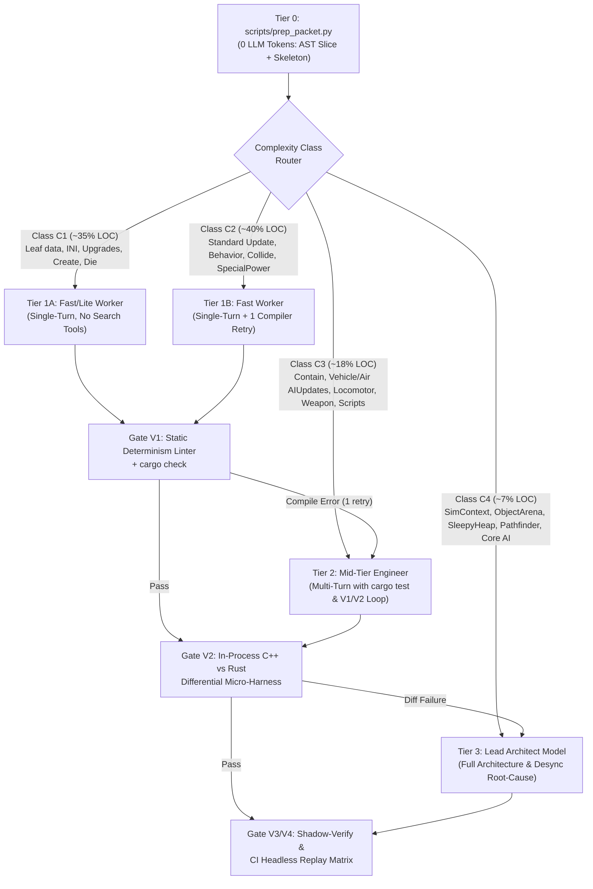
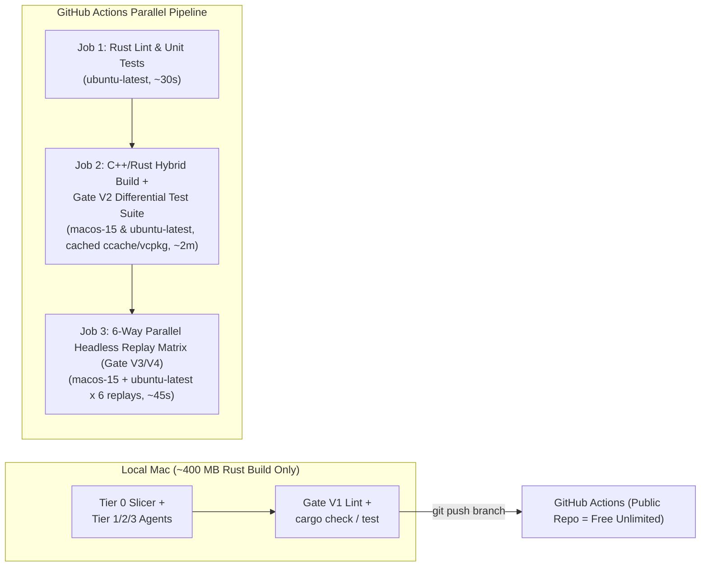

# Multi-Agent Token Optimization, Compartmentalized V&V, and Public CI Offload Architecture

This document defines the operational engineering system for translating ~330,000 lines of C++ (`871` files across `Core/GameEngine` and `GeneralsMD/Code/GameEngine`) to Rust with minimal token burn, strict compartmentalization, automated Verification & Validation (V&V), and near-zero local Mac CPU/disk load via free GitHub Actions CI.

---

## 1. Token Optimization: Context Slicing & 4-Tier Agent Routing

### 1.1 Why Naive Agent Translation Burns 10x Too Many Tokens
In the C++ codebase, every `.cpp` file includes `PreRTS.h`, `Object.h` (40 KB), `GameLogic.h` (24 KB), `ThingTemplate.h` (45 KB), `GlobalData.h` (35 KB), and `INI.h` (21 KB).
- If an agent uses file-search/read tools to explore headers before translating each of the ~450 `.cpp` implementation files, it consumes **40,000–70,000 input tokens per file** ($\approx 25\text{M}–35\text{M}$ input tokens just on repeated header reads, plus multi-turn tool-call overhead accumulating context history).

### 1.2 Tier 0: Zero-Token Deterministic Context Slicer (`scripts/prep_packet.py`)
Before any LLM agent is invoked on a translation unit, a deterministic local Python/Clang script prepares a self-contained **Translation Packet (`packet_<module>.md`, ~3,000–4,500 tokens total)** containing:
1. **Stripped Target Source (`target.h` + `target.cpp`):** License header blocks, `#include` boilerplate, and dead `#if 0` blocks removed.
2. **AST-Extracted Dependency Signatures (`deps_context.rs`):** Using `compile_commands.json` from CMake (`clang++ -Xclang -ast-dump=json`), the script extracts *only* the exact external methods, enum variants, and struct fields actually referenced by `target.cpp`, mapped to their Rust equivalents in `zh_common` / `zh_logic`.
3. **Pre-Generated Boilerplate Skeleton (`skeleton.rs`):**
   - `ModuleData` struct definition and `INI` field-parse table extracted mechanically from `buildFieldParse(MultiIniFieldParse& p)`.
   - `Snapshot::crc` and `Snapshot::xfer` field traversal order extracted from `cls::crc` / `cls::xfer`.
   - `FacetMask` constants and `extern "C"` FFI entry points pre-populated.
4. **Compact Determinism Cheat Sheet (`RUST_CONVENTIONS_CHEATSHEET.md`, ~800 tokens):** The 10 determinism rules reduced to concrete code idioms (`wrapping_add`, `gm_*f`, `BTreeMap`, float-to-int truncation helper `cpp_f32_mul_to_i32(i, f)`).

**Token Reduction Impact:**
- Per-module input prompt drops from **~50,000 tokens (multi-turn exploration)** to **~3,800 tokens (single-turn, zero-tool-call transformation)** — an **~88% reduction in token consumption**.

---

### 1.3 Four-Tier Agent Routing Matrix (Complexity vs. Model Cost)

We classify every work unit into four complexity classes (`C1`..`C4`) and route each to the lowest-cost agent tier capable of >90% first-pass accuracy:



| Complexity Class | Codebase Share | Target Files & Modules | Assigned Agent Tier | Execution Mode |
|---|---:|---|---|---|
| **Class C1: Leaf & Data Modules** | **~35%** (~115k LOC, ~310 files) | `RandomValue`, `crc`, `XferCRC`, `BitFlags`, `Money`, `Energy`, `ScoreKeeper`, `Handicap`, `Science`, `RankInfo`, `Armor`, `FiringTracker`, `ExperienceTracker`, `Common/INI/*` (28 files), `Object/Destroy/*` (1), `Object/Damage/*` (3), `Object/Create/*` (8), `Object/Helper/*` (8), `Object/Die/*` (12), `Object/Upgrade/*` (21), `Object/SpecialPower/*` (11), `Object/Collide/*` (20), simple `Object/Body/*` (6). | **Tier 1A (Fastest / Lite Model)** | **Single-turn, zero-tool sandbox.** Reads `packet_<mod>.md`, outputs `<mod>.rs`. Zero codebase search allowed. |
| **Class C2: Standard Stateful Modules** | **~40%** (~130k LOC, ~380 files) | ~60 of 86 `Object/Update/*` files (timers, detectors, stealth, weapon triggers, dock/exit queues, EMP, radar, power plant, OCL updates), ~22 of 30 `Object/Behavior/*` files (`AutoHeal`, `Minefield`, `Overcharge`, `Poisoned`, `TechBuilding`, `Countermeasures`, `DumbProjectile`, `InstantDeath`, `GrantStealth`), `ActiveBody`, `StructureBody`, `TeamFactory`, `CrateSystem`, `CaveSystem`, `SidesList`, `PolygonTrigger`, `VictoryConditions`. | **Tier 1B (Fast Model)** | **Single-turn + 1 compiler-error feedback loop.** If `cargo check` or `Gate V1` fails after 1 retry, escalates automatically to Tier 2. |
| **Class C3: Complex Multi-Facet & Domain Subsystems** | **~18%** (~60k LOC, ~130 files) | `Object/Contain/*` (13 files: `OpenContain`, `TransportContain`, `GarrisonContain`, `OverlordContain`, `HelixContain`, `TunnelContain`, `InternetHackContain`), complex `Object/Behavior/*` (8 files: `BridgeBehavior`, `ParkingPlaceBehavior`, `PropagandaTowerBehavior`, `RebuildHoleBehavior`, `SlowDeathBehavior`, `SpawnBehavior`, `PrisonBehavior`, `POWTruckBehavior`), complex `Object/Update/*` (26 files: `PhysicsUpdate`, `MissileAIUpdate`, `LaserUpdate`, `JetAIUpdate`, `ChinookAIUpdate`, `SupplyTruckAIUpdate`, `WorkerAIUpdate`, `DozerAIUpdate`, `ProductionUpdate`, `HordeUpdate`, `SlavedUpdate`), `Weapon.cpp`, `WeaponSet.cpp`, `Locomotor.cpp`, `TurretAI.cpp`, `ScriptConditions.cpp` (split into 10 function-group packets), `ScriptActions.cpp` (split into 15 function-group packets). | **Tier 2 (Mid-Tier Engineer Model)** | **Bounded tool loop (`cargo test` + `Gate V1/V2`).** Translates packet and runs in-process differential test harness until `Gate V2` passes. |
| **Class C4: Architectural Spine & Desync Triage** | **~7%** (~25k LOC, ~51 files) | `SimContext`, `ObjectArena`, `ModuleArena`, `SleepyUpdateHeap` (`m_sleepyUpdates`), `RustBehaviorModuleAdapter` (universal C++ proxy), `Object.cpp`, `PartitionManager.cpp`, `TerrainLogic.cpp`, `Pathfinder` (`Pathfind*.cpp`, `AIPathfind.cpp`), `AI.cpp`, `AIGroup.cpp`, `AIPlayer.cpp`, `AISkirmishPlayer.cpp`, `AIUpdate.cpp`, `AIStateMachine.cpp`, `AIStates.cpp`, `Player.cpp`, `Team.cpp`, `ScriptEngine.cpp`, `GameLogic.cpp`, `Recorder.cpp`. | **Tier 3 (Lead Architect / Frontier Model)** | **Full architectural authority.** Designs seams, reviews interface contracts, implements C4 spine, and resolves any `Gate V2/V3/V4` desync escalations. |

---

## 2. Compartmentalization with Strict V&V Checkpoints

To allow multiple worker agents to translate Class C1/C2/C3 modules in parallel without stepping on each other or introducing hidden replay desyncs, we enforce **strict physical compartmentalization** and a **4-Gate V&V Funnel**.

### 2.1 File & Crate Compartmentalization Rules
1. **One File Per Module (`crates/zh_logic/src/modules/<category>/<module_name>.rs`):**
   - Each of the 222 `BehaviorModule` classes maps to its own isolated `.rs` file (e.g., `crates/zh_logic/src/modules/behavior/auto_heal.rs`).
   - Worker agents are granted write permission **only** to their assigned `<module_name>.rs` file and its paired unit test file. They cannot edit `ObjectArena`, `ModuleArena`, `SimContext`, or `CMakeLists.txt`.
2. **Pre-Locked Trait/Enum Signatures:**
   - The Tier 3 Architect pre-defines the `ModuleTrait` signature and the `SimWorld` query/mutation API (`world.damage_object(...)`, `world.logic_random_i32(lo, hi)`, `world.find_object(id)`).
   - Worker agents code strictly against this frozen API contract, meaning 10 worker agents can translate 10 modules concurrently with **zero merge conflicts**.
3. **Chunking Mega-Files (`ScriptActions.cpp`, `ScriptConditions.cpp`, `Object.cpp`, `GameLogic.cpp`):**
   - Files over 1,500 lines are never handed to a worker agent whole:
     - `ScriptConditions.cpp` (~170 KB, ~85 condition evaluators) is split by condition enum category into 10 files (`conditions/player.rs`, `conditions/team.rs`, `conditions/unit.rs`, `conditions/timer.rs`, etc.) of ~17 KB each.
     - `ScriptActions.cpp` (~270 KB, ~160 action executors) is split into 15 files (`actions/spawn.rs`, `actions/camera.rs`, `actions/ai.rs`, `actions/team.rs`, etc.) of ~18 KB each.
     - `GameLogic.cpp` (~180 KB) is split into `gamelogic/sleepy_heap.rs`, `gamelogic/commands.rs` (55 `on*` handlers), `gamelogic/crc.rs`, `gamelogic/destroy.rs`, and `gamelogic/update.rs`.

---

### 2.2 The 4-Gate Automated V&V Funnel

No translated module is enabled in the main build until it passes all four automated gates in sequence:

```
┌────────────────────────────────────────────────────────────────────────────┐
│ GATE V1: Static Determinism Linter & Typecheck (< 1s, Local / CI, 0 tokens)│
│  • scripts/lint_determinism.py blocks:                                     │
│    - HashMap / HashSet / BinaryHeap                                        │
│    - std f32::sin/cos/tan/asin/acos/atan2/sqrt/floor/ceil/powf/exp/ln      │
│    - f32::mul_add (unintended FMA contraction)                             │
│    - raw pointer < / > comparisons or pointer-keyed BTreeMap               │
│    - usize / isize in Xfer serialization calls                             │
│  • cargo check --workspace --all-targets                                   │
└─────────────────────────────────────┬──────────────────────────────────────┘
                                      ▼
┌────────────────────────────────────────────────────────────────────────────┐
│ GATE V2: In-Process C++ vs Rust Differential Micro-Harness (~2s, Zero .big)│
│  • Links libzh_ffi.a + z_gameengine into a headless GTest/Cargo test runner│
│  • Instantiates C++ Module and Rust Module side-by-side in memory          │
│  • Runs 1,000 seeded fuzz & boundary steps (lo>=hi, negative floats,       │
│    disabled masks, level promotions, damage deaths, xfer save/load)        │
│  • Asserts 100% bit-exact match on:                                        │
│    1. Return values (UpdateSleepTime, damage adjusted, bools)              │
│    2. XferSave binary snapshot bytes (byte-for-byte state equivalence)     │
│    3. XferCRC state hash                                                   │
│    4. GetGameLogicRandomSeedCRC() (verifies exact PRNG call count & args)  │
└─────────────────────────────────────┬──────────────────────────────────────┘
                                      ▼
┌────────────────────────────────────────────────────────────────────────────┐
│ GATE V3: Lockstep Shadow-Verify Smoke Replay (~15s, Single Fast Replay)    │
│  • Runs GeneralsXZH -headless -replay macos_2p_vanilla_map.rep with        │
│    #[cfg(feature = "shadow-verify")] active for the newly ported batch     │
│  • Both C++ and Rust implementations execute on every live frame call      │
│  • Panics with exact frame, ObjectID, call stack, and field diff on the    │
│    very first divergence (without waiting for the 100-frame CRC interval)  │
└─────────────────────────────────────┬──────────────────────────────────────┘
                                      ▼
┌────────────────────────────────────────────────────────────────────────────┐
│ GATE V4: Full Corpus Replay Matrix (~45s in GitHub Actions 6-Way Matrix)   │
│  • Runs all 6 GeneralsXReplays (3 Linux x86_64 + 3 macOS arm64) + custom   │
│    skirmish replays with shadow-verify OFF (Rust running solo in the seam) │
│  • Must exit 0 with zero CRC mismatches across all frames                  │
└────────────────────────────────────────────────────────────────────────────┘
```

**Why Gate V2 Is the Secret Weapon for Compartmentalized V&V:**
Gate V2 tests a single module (e.g., `ExperienceTracker`, `Energy`, `AutoHealBehavior`, `Locomotor`) against the original C++ implementation in-memory across 1,000 randomized edge-case inputs in **2 seconds**, **without needing retail `.big` files or running a full 20,000-frame replay**. If a cheap Tier 1 agent misses an `Int * Real` float truncation or an early return before a `GameLogicRandomValue` call, Gate V2 catches it in 2 seconds and pinpoints the exact input seed that diverged!

---

## 3. Leveraging Free GitHub Actions CI (Public Repo Strategy) to Offload Local Workload

### 3.1 Why Public GitHub Repo CI Changes the Economics
- **Local Mac Constraints:** Your Apple Silicon Mac currently has **~13 GiB free disk space** and is your active daily workstation. Building 600k lines of C++ (`GeneralsX` + `vcpkg` + `MoltenVK` + `FFmpeg` + debug symbols) and running multi-process replay suites locally consumes 6–10 GiB of disk and saturates local CPU cores.
- **GitHub Hosted Runners for Public Repositories:**
  - Public GitHub repositories receive **unlimited free minutes** on standard GitHub-hosted runners:
    - `macos-15` (Apple Silicon M1 `arm64`, 3 vCPU, 7 GB RAM, 14 GB free SSD)
    - `ubuntu-latest` (`x86_64`, 4 vCPU, 16 GB RAM, 14 GB free SSD)
  - Up to **20 concurrent jobs** run in parallel at zero cost.
- **Public Readiness of `chayuto/generals-rust`:**
  - Because `generals-rust` has zero EA trademarks in its repo/crate/binary names, includes the full `GPL-3.0-or-later` + EA Section 7 `LICENSE.md` with Notice of Modification, and enforces `.gitignore` + `.githooks/pre-commit` blocking all proprietary assets and attribution trailers, **the repository is safe to make public at any time** to unlock unlimited free CI.

### 3.2 Three-Stage CI Offload Pipeline (`.github/workflows/`)



1. **Workflow 1: `ci-fast-verify.yml` (Zero Retail Assets Required — Runs on Every Push/PR):**
   - **Step A (`rust-check`, ~30s):** Runs `scripts/lint_determinism.py` (`Gate V1`), `cargo fmt --check`, `cargo clippy`, and pure-Rust unit tests (`cargo test --workspace`).
   - **Step B (`hybrid-diff-tests`, ~2 min with `ccache` + `vcpkg-bincache`):**
     - Checks out `fbraz3/GeneralsX` at pinned commit `84a7a20769aa5749f388b1f49bd542c79b3c33e8`.
     - Restores `vcpkg-bincache` and `ccache` from `actions/cache` (so C++ files are almost 100% cache hits after the first run!).
     - Links `libzh_ffi.a` into `z_gameengine` and runs **Gate V2 (In-Process C++-vs-Rust Differential Tests)** + `z_googletest`.
     - Uploads the compiled `GeneralsXZH` `arm64` macOS bundle as a downloadable workflow artifact!
2. **Workflow 2: `ci-replay-matrix.yml` (6-Way Parallel Headless Replay Verification — `Gate V3/V4`):**
   - Mirrors `fbraz3/GeneralsX/.github/workflows/replay-tests.yml`:
     - Clones public `generalsx-project/GeneralsXReplays` (6 cross-platform Zero Hour replays + custom maps).
     - Restores the read-only headless `.big` test bundle from `actions/cache` (populated on cache miss from an encrypted archive decrypted via repository secret `secrets.ASSETS_KEY`, which is never exposed to public viewers or fork PRs).
     - Spawns a **6-job parallel matrix** (one job per replay: `macos_2p_vanilla_map.rep`, `macos_2p_custom_map.rep`, `macos_6p_custom_map.rep`, `linux_2p_vanilla_map.rep`, `linux_2p_custom_map.rep`, `linux_6p_custom_map.rep`).
     - Each job runs `./GeneralsXZH -headless -replay <rep>` with a 180-second timeout, and on any CRC mismatch automatically re-runs with `-DebugCRCFromFrame (F-2) -DebugCRCUntilFrame (F+1) -LogObjectCRCs -SaveDebugCRCPerFrame` and uploads the frame CRC diff artifact for instant Tier 3 diagnosis!

### 3.3 How This Lightens Your Local Mac Workload
With this CI pipeline active:
1. **No 8 GiB C++ Build Tree Needed Locally:** If you want to save local disk space, your Mac only needs:
   - `~/Games/generalszh` (~3.2 GiB, downloaded once via `steamcmd` App `2732960` for local spot-checks or recording replays),
   - A pre-built `GeneralsXZH` binary + `libz_gameengine.a` static archive downloaded from our CI artifact (~150 MB) or a single stripped Release build,
   - The local Rust `target/` directory (~350 MB).
   - **Total local disk footprint stays under ~3.8 GiB** (leaving >9 GiB free on your Mac).
2. **Zero Local CPU Contention During Batch Translation:** Agents run `Gate V1` (Python determinism linter + `cargo check`) locally in < 2 seconds, push a batch branch of 5–10 translated modules, and let GitHub's cloud runners do the C++ linking, `Gate V2` differential fuzzing, and 6-way parallel replay simulations!
