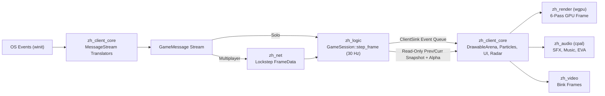
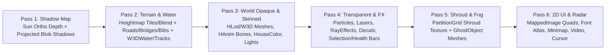

# Client, Assets, Renderer, Audio/Video & Multiplayer Architecture Plan (Stages 2–6)

> **Scope:** Everything outside the bit-exact simulation (`GameLogic`): retail assets & client INI (Stage 2), modern GPU renderer (Stage 3), interface/menus/input (Stage 4), audio & Bink video (Stage 5), and UDP lockstep multiplayer + C++ retirement (Stage 6).
> **Parent Plan:** [FULL_PORT_PLAN.md](FULL_PORT_PLAN.md) | **Simulation Plan:** [STAGE1_COMPLETION_PLAN.md](STAGE1_COMPLETION_PLAN.md)

---

## 1. Logic <-> Client Boundary & Frame Architecture

Measured call counts across `GeneralsMD/Code/GameEngine/Source/GameLogic/**/*.cpp` define the exact boundary that `zh_logic` crosses:

| C++ Client Call Site in `GameLogic` | Call Sites / Files | Pure-Rust Replacement Strategy |
|---|---|---|
| `TheAudio->addAudioEvent(...)` / `killAudioEvent` | 253 calls / 51 files | Emit `ClientEvent::Audio(...)` via `ClientSink`; played by `zh_audio` after frame |
| `Object::getDrawable()` | 249 calls / 81 files | Visual state (conditions, selection decals, laser endpoints) sent via `ClientEvent`; bone queries move to startup `ModelBoneCatalog` |
| `TheInGameUI` (messages, radar alerts, selection) | 117 calls / 31 files | Emit `ClientEvent::Ui(...)`; `zh_client_core::InGameUI` handles display/beacons/messages |
| `TheParticleSystemManager` | 96 calls / 24 files | Emit `ClientEvent::Particle(...)`; `zh_client_core::particles` steps particles |
| `TheTacticalView` (camera shake, look-at, screen) | 80 calls / 5 files | Emit `ClientEvent::Camera(...)`; `zh_client_core::view` applies outside sim |
| `TheRadar` (add/remove/color/events) | 59 calls / 25 files | Logic maintains authoritative `Radar` object list/events; `zh_render` draws minimap texture |
| `TheControlBar` (dirty/update cameo state) | 49 calls / 14 files | `ClientEvent::ControlBarDirty`; `zh_client_core::control_bar` reads immutable `SimView` after frame |
| `TheGameClient` (`createDrawable`, `destroyDrawable`, `setFrame`) | 47 calls / 13 files | Driven by `ClientEvent::ObjectCreated` / `ObjectDestroyed` / `FrameAdvanced(u32)` |
| `TheEva->setShouldPlay(...)` | 38 calls / 15 files | Emit `ClientEvent::Eva(EvaEventType, player)`; `zh_audio` queues speech |
| `getPristineBonePositions` / `getBarrelCount` | 27 + 1 calls / 16 files | **Moved to startup `RulesRegistry::model_bones` (`ModelBoneCatalog`)** in `L3` |
| `GameClientRandomValue` | 18 calls / 9 files | Client-owned `ClientRng` inside `zh_client_core`; **never touches `LogicRngState`** |
| `TheDisplay` / `TheTerrainVisual` / `TheFXListStore` | 17 + 11 + 5 calls | `ClientEvent::TerrainVisual(...)` / `ClientEvent::FxList(...)` / `ClientEvent::Movie(...)` |

### Unidirectional Execution Loop (`zh_app`)

- **Fixed Logic Step + Visual Interpolation:** `zh_app` steps `GameSession::step_frame()` at fixed `1/30 s` (`33.333 ms` default, adjustable for replay speed/fast-forward), stores `(prev_pose, curr_pose)` per object in `RenderSnapshot`, and passes interpolation factor `alpha in [0.0, 1.0]` to `zh_client_core` / `zh_render` for smooth 60/120+ FPS rendering.
- **No Re-Entrant Simulation:** `ClientSink` appends `ClientEvent` values into a `Vec<ClientEvent>` drained *after* `step_frame()` finishes, preserving `SimContext` borrow-splitting cleanly.

---

## 2. Proposed External Crates (For Owner Decision #12)

> **No external crates are added today.** `zh_assets` (Stage 2), `zh_client_core` (Stage 3–4 state/UI/input), and `zh_net` (Stage 6 networking) require **zero external crates**. Approval of the table below is only needed before starting `zh_render` (`R2`), `zh_app` (`U6`), and `zh_audio`/`zh_video` (`S1`–`S3`).

| Stage | Target Crate | Proposed External Crate | Role | License | Implementation Type |
|---|---|---|---|---|---|
| **Stage 3 (`R2`)** | `zh_render` | `wgpu` | Cross-platform GPU rendering (Metal on macOS `arm64`, Vulkan on Linux, DX12/Vulkan on Windows) | MIT / Apache-2.0 | Pure Rust wrapping OS graphics APIs (`wgpu-hal`) |
| **Stage 3 (`R8`)** | `zh_render` | `fontdue` *(or `ab_glyph`)* | Runtime TrueType/OpenType glyph rasterization for `W3DGameFont` + Unicode CSF strings | MIT / Apache-2.0 | 100% pure Rust (no `freetype`/`fontconfig` C deps) |
| **Stage 4 (`U6`)** | `zh_app` | `winit` | Window creation, resize/DPI, raw keyboard/mouse events | Apache-2.0 | Pure Rust wrapping Cocoa / Win32 / Wayland / X11 |
| **Stage 5 (`S1`)** | `zh_audio` | `cpal` | Cross-platform audio output callback stream (CoreAudio / WASAPI / ALSA) | Apache-2.0 | Pure Rust wrapping OS audio APIs |
| **Stage 5 (`S1`)** | `zh_audio` | `symphonia` | Decode retail `.wav` (PCM / IMA-ADPCM) and `.mp3` music/voices from memory | MPL-2.0 *(GPLv3-compatible)* | 100% pure Rust |
| **Stage 5 (`S3`)** | `zh_video` | **Option A (Rec):** None — clean-room Rust decoder **Option B:** `ffmpeg-next` | Decode retail `.bik` (Bink 1) video & Bink audio streams | **A:** GPL-3.0-or-later **B:** GPL/LGPL C FFI | **A:** 100% pure Rust (~2.5k–3.5k LOC, honors "no C++") **B:** Links system C FFmpeg libs |

---

## 3. Stage 2: Retail Asset Readers & Client INI (`zh_assets` + `zh_common::io`)

### 3.1 Already Ported vs. Remaining Formats

- **Already Working (`0` external crates):** `.big` archive VFS (`big_file_system.rs`), RefPack/ZLib compression (`compression.rs`), `DataChunk` stream (`data_chunk.rs`), `.map` heightmap + objects + sides (`height_map.rs`, `map_object.rs`, `sides_list.rs`), `.w3d` mesh/HLod/hierarchy/HAnim + `Model::pristine_bones` / `barrels()` (`crates/zh_assets/src/w3d/`, `model.rs`), `.dds` (`dds.rs`), `.tga` (`tga.rs`), `.csf` (`csf.rs`), `.rep` (`recorder.rs`).
- **Remaining in Stage 2 (`A1`–`A3`):**

| Slice | Scope | Target Crate | Est. Workers | Automated Verification Oracle |
|---|---|---|---:|---|
| **A1** | Remaining binary/text asset readers: `.str` string table, `.wnd` UI layout grammar + AST, `.wak` water tracks, `.ani`/`.cur` animated cursors, visual `.map` chunks (`BlendTileData` textures/cliff/extra-blend, `WorldInfo`, `GlobalLighting`, `MPPositionList`, `PostEffects`, object draw flags) | `zh_assets`, `zh_common` | 2 | Corpus parse of every retail file across all 36 `.big` archives (`0` failures) + C++ dump parity (`gen_ast_assets.cpp` style) |
| **A2** | All 30 `CLIENT_BLOCKS` INI parsers currently skipped in `game_engine.rs` (`MappedImage`, `Animation`, `FXList`, `ParticleSystem`, `InGameUI`, `ControlBarScheme`, `ControlBarResizer`, `ShellMenuScheme`, `WindowTransition`, `CommandMap`, `Mouse`, `MouseCursor`, `DrawGroupInfo`, `AudioEvent`/`DialogEvent`/`MusicTrack`/`AudioSettings`/`MiscAudio`, `EvaEvent`, `Video`, `Campaign`, `ChallengeGenerals`, `Credits`, `WaterSet`/`WaterTransparency`, `Weather`, `GameLOD`/`LODPreset`, `Language`, `MapCache`, `HeaderTemplate`, `OnlineChatColors`) | `zh_assets` / `zh_client_core`, `zh_logic` (`game_engine.rs` hook) | 2 | Startup `GameDataLoader` report reaches `0` skipped `CLIENT_BLOCKS` on retail `.big` files; field values checked against C++ `INI` dumps |
| **A3** | `ModelBoneCatalog`: resolve `W3DModelDraw` condition-state models across all `ThingTemplate`s, compute `PristineBones` + `barrels()` once at startup for both `zh_logic` (`L3`) and `zh_client_core` | `zh_assets`, `zh_logic` | 1 | C++ `W3DModelDraw::validateCachedBones` / `getBarrelCount` differential dump across every retail unit & structure |

**Stage 2 Exit Gate (`v1.1.0-assets`):** Every `.big`-archived asset file and all 62 INI block types in retail *Zero Hour* parse cleanly in pure Rust with verified layout/hash parity.

---

## 4. Stage 3: Native Modern Renderer (`zh_client_core` + `zh_render`)

Rather than translating `WW3D2` (`103k` LOC of DirectX 8 vertex-pool and fixed-function wrappers) line-by-line, Stage 3 replaces DX8 with a clean **6-pass `wgpu` + WGSL pipeline** (`~15k–22k` Rust + WGSL LOC) driven by `zh_client_core` state machines:

### Stage 3 Slices (`R1`–`R8`)

| Slice | Crate | Pure-Rust / Crate | Scope (C++ Counterparts Replaced) | Est. Workers | Verification Oracle |
|---|---|---|---|---:|---|
| **R1** | `zh_client_core` | **0 ext crates** | `TacticalView` camera/frustum/ray-picking (`Display.cpp`, `TacticalView.cpp`), `DrawableArena`, `W3DModelDraw` condition-state selector + `HAnim` pose evaluator, `W3DTankDraw`/`Truck`/`Overlord`/`Dependency`/`Debris`/`Supply` logic | 2 | Headless golden state dumps vs C++ `Drawable::update` / condition selection & screen-to-world picking |
| **R2** | `zh_render` | `wgpu` | `wgpu` device/swapchain/offscreen PNG target, terrain chunked mesh + multi-layer tile atlas + blend/extra-blend + cliff UVs (`BaseHeightMap.cpp`, `TerrainTex.cpp`) | 1–2 | Offscreen `wgpu` PNG vs C++ `GeneralsXZH` terrain-only screenshot at fixed camera |
| **R3** | `zh_render` | `wgpu` | Animated water (`W3DWater.cpp`), shoreline `W3DWaterTracks`, road splines (`W3DRoadBuffer`), bridges (`W3DBridgeBuffer`), building bibs (`W3DBibBuffer`), sun + `W3DDynamicLight` + `GlobalLighting` | 2 | Offscreen screenshot comparison on river/bridge maps (`golden_render_terrain`) |
| **R4** | `zh_render` | `wgpu` | W3D skinned/hierarchical mesh pipeline, HouseColor tinting, `W3DTreeBuffer` & `W3DPropBuffer` instancing, `ClientEvent` sync with live `zh_logic` replay playback | 2 | Live replay frame-100/500/1000 render PNGs compared vs stock `GeneralsXZH` |
| **R5** | `zh_render` | `wgpu` | Directional shadow map + projected decals (`W3DShadow`, `W3DProjectedShadow`, `W3DVolumetricShadow` replacement), `RadiusDecalUpdate`, scorches, treads | 1 | Shadow/decal visual comparison against C++ screenshots |
| **R6** | `zh_client_core` + `zh_render` | `wgpu` | `ParticleSystem` emitter/physics/instanced billboard/streak renderer (`ParticleSys.cpp`), `FXList`, `W3DLaserDraw`, `RayEffect`, `Smudge`, `CameraShakeSystem` | 1–2 | Particle simulation step tests (0 crates) + combat scene render comparison |
| **R7** | `zh_render` | `wgpu` | Per-player shroud/fog texture from `PartitionGrid`, `GhostObject` frozen fogged-building rendering, selection rings, health/ammo/veterancy/construction bars, placement legality preview, rally lines | 1 | Fog-edge + selection/build preview render parity test |
| **R8** | `zh_render` | `wgpu` + `fontdue` | Scissor-clipped `MappedImage` 2D quad batcher, runtime font glyph atlas (`W3DGameFont`), `Radar` minimap render target + unit blips/camera trapezoid/pings (`W3DRadar`) | 1 | Deterministic 2D quad/font/radar PNG golden tests |

**Stage 3 Exit Gate (`v1.2.0-render`):** Live headless replay playback drives `zh_render` to produce faithful offscreen/windowed frames matching reference `GeneralsXZH` screenshots across terrain, units, battles, shroud, and minimap.

---

## 5. Stage 4: Interface, ControlBar, Menus & Input (`zh_client_core` + `zh_app`)

Putting `GameWindowManager`, all 11 gadgets, `ControlBar`, `InGameUI`, `Shell`, and `MessageStream` translators inside `zh_client_core` (**0 external crates**) makes ~95% of UI code unit-testable without opening a window:

| Slice | Crate | Scope (C++ Counterparts) | Est. Workers | Verification Oracle |
|---|---|---|---:|---|
| **U1** | `zh_client_core` | `GameWindow`, `GameWindowManager`, `.wnd` screen loader & callback dispatch, layout resolution scaling, `AnimateWindowManager`, `GameWindowTransitions` | 1–2 | Layout coordinate/flag dump parity vs C++ `GameWindowManager` across retail `.wnd` files |
| **U2** | `zh_client_core` | All 11 gadgets (`PushButton`, `CheckBox`, `RadioButton`, `HorizontalSlider`, `VerticalSlider`, `ListBox`, `ComboBox`, `ProgressBar`, `StaticText`, `TextEntry`, `TabControl`) + `DisplayStringManager` | 2 | Automated click/scroll/type interaction tests & rendered quad command snapshots |
| **U3** | `zh_client_core` | Input & `MessageStream` translators (`Keyboard`, `Mouse`, `HotKey`, `CommandMap`, `LookAtXlat`, `SelectionXlat`, `PlaceEventTranslator`, `CommandXlat`, `GUICommandTranslator`, `MetaEvent`, `HintSpy`) | 1–2 | Golden input-sequence-to-`GameMessage` output parity vs C++ translators |
| **U4** | `zh_client_core` | `InGameUI` & `ControlBar` (context command grid, cameo icons, production queue/cancel, multi-select, general's powers/science window, observer controls, hover tooltips, build preview placement, radar click-to-pan/command, beacons, in-game chat/diplomacy) | 2 | Headless `ControlBar` state test against live `SimView` + UI quad snapshot |
| **U5** | `zh_client_core` | `Shell` & core menus (Main Menu, Skirmish setup — map/faction/color/AI/starting cash/superweapon limit, Load screen, Pause/Options/Save-Load/Quit, Victory/Score summary, Replay browser, Keyboard/Game options) | 2 | Scripted navigation test: Main Menu -> Skirmish setup -> `GameOptions` -> start match -> Victory |
| **U6** | `zh_client_core` + `zh_app` | Campaign & Challenge Generals menus + `zh_app` binary (`generals-zh`: `winit` event loop, fixed 30 Hz `GameSession` step, visual interpolation, pause/speed controls, cursor rendering) | 1 | End-to-end human-input skirmish soak test in `generals-zh` (build base, train units, fight, win/lose) |

**Stage 4 Exit Gate (`v1.4.0-playable`):** A player launches `generals-zh`, sets up and plays a complete solo skirmish or campaign mission to victory/defeat with full UI, mouse/keyboard controls, save/load, and replay playback.

---

## 6. Stage 5: Audio & Video (`zh_audio` + `zh_video`)

| Slice | Crate | Scope (C++ Counterparts) | Est. Workers | Verification Oracle |
|---|---|---|---:|---|
| **S1** | `zh_audio` | `AudioManager` core mixer (3D spatial attenuation/pan, priority/voice-count stealing, volume channels, pitch/delay/looping via `AudioRandomValue`), `.wav` (PCM/IMA-ADPCM) + `.mp3` decode via `symphonia` from `.big`, `cpal` device output | 1–2 | Decode-every-retail-sound corpus check (`0` panics) + deterministic headless mixer priority/stealing tests |
| **S2** | `zh_audio` | `MusicManager` (ambient/battle/victory playlists + completion callback feeding `SCRIPT_MUSIC_TRACK_HAS_COMPLETED`), `Sound` & `Speech` / `EVA` priority queue with cooldowns | 1 | Headless playlist/EVA queue state machine tests |
| **S3** | `zh_video` | `VideoPlayer` Bink 1 (`.bik`) video & Bink audio decoder (pure Rust recommended per Decision #12), A/V clock sync, RGBA/YUV upload into `zh_render` | 1–2 | Decode & frame-count/CRC check over all 70 retail `.bik` files |
| **S4** | `zh_app` | Wire `ClientEvent::Audio`, `ClientEvent::Eva`, `ClientEvent::Music`, `Shell` background video, and briefing/credits cutscenes | 1 | Full A/V smoke test across menu, skirmish combat, and cutscene playback |

**Stage 5 Exit Gate (`v1.6.0-av`):** Sound effects, 3D battle audio, unit voice acknowledgements, EVA alerts, dynamic music, and retail `.bik` videos play in sync.

---

## 7. Stage 6: Lockstep Networking & C++ Retirement (`zh_net`)

Multiplayer in *Zero Hour* uses **deterministic lockstep**: all peers simulate the exact same 30 Hz frames and exchange only stamped `GameMessage` commands + per-frame `GameLogic::getCRC()` hashes. Because `zh_logic` already enforces bit-exact cross-platform determinism, `zh_net` builds cleanly on `std::net::UdpSocket` with **zero external crates**:

- **Dropped permanently:** Legacy GameSpy / WOLBrowser (`13.5k` LOC — servers shut down).
- **Deferred (post-`v2.0.0` optional):** `GeneralsOnline` (`6.3k` LOC community REST/lobby services).

| Slice | Crate | Scope (C++ Counterparts) | Est. Workers | Verification Oracle |
|---|---|---|---:|---|
| **N1** | `zh_net` | `Transport` (`std::net::UdpSocket`), `NetPacket` / `NetPacketStructs` binary codec, `NetCommandMsg` / `NetCommandList` / `NetCommandWrapperList` (fragmentation, acks, resend, keepalive) | 1 | Packet roundtrip + fuzz/loss/fragmentation unit tests |
| **N2** | `zh_net` | `FrameData`, `FrameDataManager`, `FrameMetrics`, `Connection`, `ConnectionManager` (lockstep frame-ahead buffer, dynamic `runAhead`, per-frame CRC broadcast & mismatch detection) | 1–2 | Deterministic in-process 2p–6p virtual-network simulator with packet loss, jitter, reordering, and intentional CRC tamper check |
| **N3** | `zh_net` | `DisconnectManager` (disconnect timeout/vote flow, safe player drop without desyncing survivors) + `Network` session bridge to `GameSession` | 1 | Simulated mid-game peer drop + resume CRC parity test |
| **N4** | `zh_net` + `zh_client_core` | `LANAPI`, `LANGameInfo`, `FileTransfer` (UDP LAN broadcast discovery, staging lobby chat/slot/ready/map transfer) + Direct-IP connect menu UI | 1–2 | Loopback multi-peer LAN discovery, lobby countdown, and custom map transfer test |
| **N5** | All | Live 2p–6p Rust-vs-Rust LAN match soak tests + **C++ Retirement**: verify zero C++ dependencies (`otool -L` / `ldd`), archive `zh_ffi` test-only status, final documentation sign-off | 1 | Complete live two-process LAN match from lobby to victory with matching frame CRCs and zero C++ linked |

**Stage 6 Exit Gate (`v2.0.0`):** Two or more pure-Rust `generals-zh` instances discover each other on LAN (or connect via Direct-IP), transfer maps, play a full match in deterministic lockstep with live CRC verification, and ship with **zero C++**.
