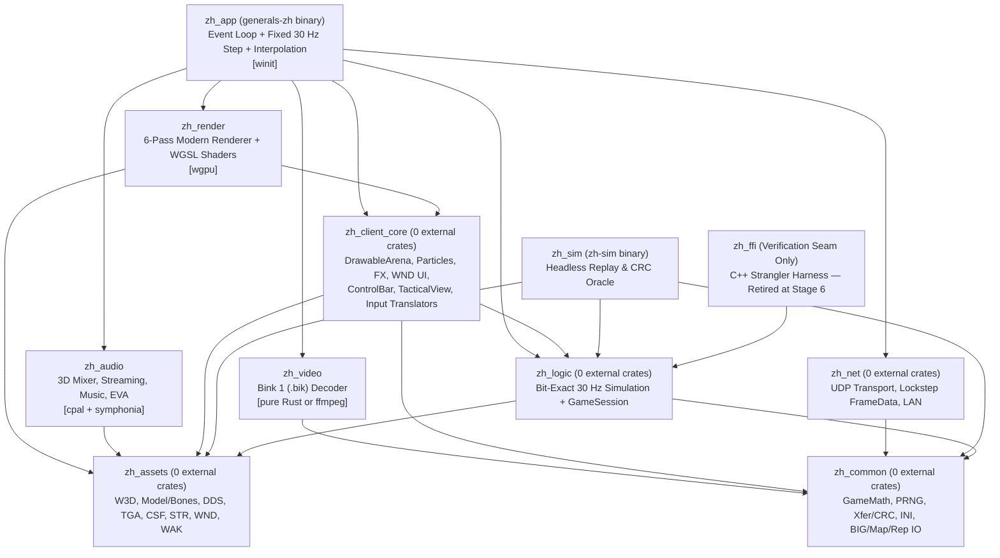
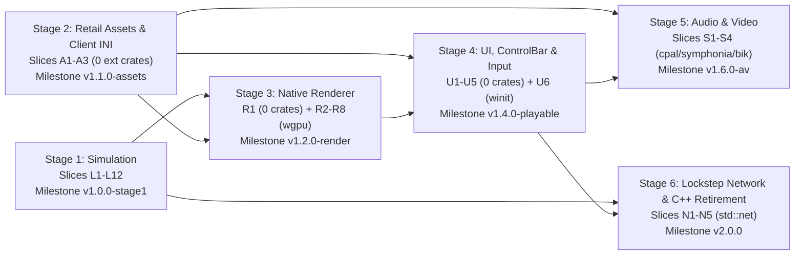

# Full Port Architecture & End-to-End Completion Plan (`generals-rust`)

> **Owner Goal (2026-11-27):** A complete, playable, 100% pure-Rust port of *Zero Hour* (simulation, assets, renderer, interface, audio, video, and lockstep networking), with zero C++ in the finished game. The C++ reference (`fbraz3/GeneralsX` @ `84a7a20769aa5749f388b1f49bd542c79b3c33e8`) remains strictly read-only as the verification oracle until Stage 6 completes.

This document is the master architectural and execution plan across **Stages 1–6**. Detailed slice schedules live in two companion blueprints:
- **Simulation to Replay CRC Parity (Stage 1):** [STAGE1_COMPLETION_PLAN.md](STAGE1_COMPLETION_PLAN.md) (Slices `L1`–`L12`)
- **Native Client, Renderer, UI, A/V & Networking (Stages 2–6):** [CLIENT_ARCHITECTURE_PLAN.md](CLIENT_ARCHITECTURE_PLAN.md) (Slices `A1`–`A3`, `R1`–`R8`, `U1`–`U6`, `S1`–`S4`, `N1`–`N5`)

---

## 1. Verified Baseline Snapshot (2026-11-28, commit `bdf42e6`)

| Metric | Current State | Notes |
|---|---|---|
| **Workspace Crates** | 4 crates, `0` external dependencies | `zh_common` (14,625 src / 4,481 test LOC), `zh_logic` (155,065 / 82,784), `zh_ffi` (3,912 / 0), `zh_assets` (2,510 / 1,204); **total 176,112 src + 88,469 test LOC** |
| **Golden Suites** | `125` suites in `PORT_MAP.md` (`126` files in `docs/golden_vectors/`), `120` `golden_*.rs` | Verified against unmodified `libz_gameengine.a` at `-O0`, `-O2`, `-O2 --sanitize` |
| **Manifest Accounting** | `291` implemented, `36` data-only, `136` unported (`463` total) | `11` "implemented" packets are partial ([HANDOFF.md](HANDOFF.md)); ~`70+` "unported" packets are C++-only memory/platform/debug glue and ~`27+` belong to Stages 2–5 |
| **Retail Startup Parity** | 24/24 games match at game start | Map INI, terrain, sides, bridges, and computer map setup match stock digests ([game_logic.rs](../crates/zh_logic/src/gamelogic/game_logic.rs)) |
| **300-Frame Ratchet** | `golden_game_frames` across 24 games | `human.count` 24/24, `human.ai` 22/24, `human.position` 21/24, `map.count` 20/24, `computer.count` 20/24, `game`/`player` 19/24, `seed` 9/24, `computer.position` 5/24 |
| **In-Engine FFI Swaps** | 12 C++ entry points swapped into `GeneralsXZH-rust` | 996/996 replay checkpoints match ([BASELINE.md](BASELINE.md)); **Gate 0** remains open due to public replay vs local Steam data mismatch |
| **Playable Client** | None | Stage 2 asset readers (`w3d`, `dds`, `tga`, `csf`, `model`, `big`, `map`, `rep`) exist; zero rendering, UI, input, audio, video, or net |

---

## 2. Reference C++ Census & Porting Fate (`vendor/GeneralsX`)

Measured across `Core/` and `GeneralsMD/Code/` at `84a7a20`:

| C++ Tree | Files | Total Lines | Non-Comment Code ~ | Porting Strategy | Target Rust Crate(s) |
|---|---:|---:|---:|---|---|
| `GameLogic` (`GeneralsMD` + `Core`) | 268 | 190,715 | 133,936 | **Bit-exact translation** (CRC & state parity) | `zh_logic` |
| `Common` (`GeneralsMD` + `Core`) | 141 | 70,578 | 50,241 | **Bit-exact** for math/PRNG/Xfer/INI/RTS/IO; **drop** C++ memory pools/stack dump/win32 registry | `zh_common`, `zh_logic` |
| `GameClient` (`GeneralsMD` + `Core`) | 150 | 125,197 | 88,620 | **Faithful behavioral port** (`.wnd` UI, `ControlBar`, `Drawable`, `MessageStream`, `ParticleSys`, `FXList`, `InGameUI`) | `zh_client_core` |
| `GameEngineDevice` (`GeneralsMD` + `Core`) | 119 | 96,189 | 68,779 | **Clean modern rewrite** replacing DX8 (`W3DDevice` 79.8k), duplicate audio backends (9.2k), SDL3/Win32 (4.2k), video (1.6k) | `zh_render`, `zh_audio`, `zh_video`, `zh_app` |
| `WWVegas` (`WW3D2` 103k, `WWLib` 40k, `WWMath` 30k, `WWAudio` 12k, other 6k) | 496 | 191,455 | 146,985 | **Replace** `WW3D2`/`WWAudio` with `wgpu`/`cpal`; keep `WWMath` helpers in `zh_assets`; **drop** `WWLib`/`WWDebug` | `zh_assets`, `zh_render`, `zh_audio` |
| `GameNetwork` (`GeneralsMD` + `Core`) | 60 | 40,528 | 32,972 | **Port** UDP lockstep + LAN (`20.7k`); **drop** defunct GameSpy/WOLBrowser (`13.5k`); defer `GeneralsOnline` (`6.3k`) | `zh_net` |
| `Include/` Headers (all engine) | 698 | 134,770 | 93,469 | Captured inside crate structs & specs | — |
| Editors / Tools (`WorldBuilder`, etc.) | — | ~289,000 | — | **Out of scope** (not needed to play) | — |

---

## 3. Full-Game Target Rust Architecture

### 3.1 Strict Architectural Split: Pure Core vs. Thin Hardware Shell

A core design rule keeps **all game logic, asset parsing, UI layout/state, input translation, and lockstep networking in zero-dependency pure-Rust crates**, isolating OS/GPU/audio dependencies in small edge crates gated on Owner Decision #12 ([OPEN_DECISIONS.md](OPEN_DECISIONS.md)):

### 3.2 Workspace Crate Boundaries & Rules

| Crate | External Crates | Rules & Responsibilities |
|---|---|---|
| `zh_common` | **None** | `gm_*` math, PRNG, `Xfer`/`XferCRC`/`XferSave`/`XferLoad`, `BitFlags`, `NameKeyTable`, `INI` lexer, `BIGFileSystem`, `RefPack`, `DataChunk`, `MapObject`, `Recorder`, `GameLogicDispatch` core. |
| `zh_assets` | **None** | Pure parsers & geometry helpers: `.w3d`, `Model`/`Skeleton`/`PristineBones`/`Barrel`, `.dds`, `.tga`, `.csf`, `.str`, `.wnd`, `.wak`, `.ani`, visual `.map` chunks. |
| `zh_logic` | **None** | Bit-exact 30 Hz simulation: `SimContext`, `ObjectArena`, `ModuleArena`, `SleepyUpdateHeap`, `Pathfinder`, `AI`, `Scripts`, `Player`/`Team`, `GameSession`. **Never** touches GPU, audio, windowing, `HashMap`, or `std` float transcendentals. |
| `zh_sim` | **None** | Standalone CLI runner (`zh-sim -headless -replay ...`) for Stage 1 verification, CRC section bisection, and CI corpus sweeps. |
| `zh_client_core` | **None** | Pure-Rust, headlessly testable client brain: `DrawableArena`, `W3DModelDraw` state machine, `ParticleSystem` & `FXList` simulation, client INI stores, `GameWindowManager` + 11 gadgets, `ControlBar`, `InGameUI`, `TacticalView` camera/picking math, `MessageStream` input translators, `Radar` state. |
| `zh_net` | **None** (`std::net`) | Deterministic lockstep protocol (`Transport`, `NetPacket`, `ConnectionManager`, `FrameDataManager`, `DisconnectManager`, `LANAPI`, `FileTransfer`). |
| `zh_render` *(Stage 3)* | `wgpu` (+ optional `fontdue`/`ab_glyph`) | 6-pass modern GPU renderer (Shadow, Terrain/Water, World Opaque/Skinned, Effects/Overlays, Shroud/Fog, 2D UI/Radar) with offscreen PNG render oracle. |
| `zh_audio` *(Stage 5)* | `cpal`, `symphonia` | CoreAudio/WASAPI/ALSA output, `.wav`/`.mp3` decoding from `.big`, 3D spatial voices, priority/stealing, `MusicManager`, `EVA`. |
| `zh_video` *(Stage 5)* | TBD (Decision #12) | `.bik` Bink 1 video/audio playback for briefings, shell background, and cutscenes. |
| `zh_app` *(Stage 4)* | `winit` | Window creation, OS keyboard/mouse capture, fixed 30 Hz simulation accumulator + frame interpolation (`alpha`), connecting all crates into `generals-zh`. |
| `zh_ffi` *(Temporary)* | `libc`-free C-ABI | Linked into C++ `GeneralsXZH` for differential oracle tests (`Gate V2–V4`) and retired permanently after Stage 6. |

### 3.3 The Two Porting Laws

1. **Simulation (`zh_common` + `zh_logic`):** Bit-exact determinism. Preserve exact evaluation order, `f32` grouping (no FMA), `gm_*` math, PRNG call sequence, `SleepyUpdateHeap` tie order, `BTreeMap`/`BTreeSet` iteration order, and `Xfer`/`XferCRC` layouts.
2. **Client (`zh_client_core` + `zh_render`/`zh_audio`/`zh_video`/`zh_app`):** Behavioral fidelity on modern APIs. Do not port DirectX 8 fixed-function state managers (`WW3D2`) or Win32/SDL3 device boilerplate line-by-line; rewrite the GPU/OS backends cleanly against `wgpu`, `winit`, and `cpal`, while faithfully preserving `.wnd` screens, `ControlBar` behavior, input-to-`GameMessage` translation, animation conditions, particles, lighting, and shroud appearance.

### 3.4 Simulation <-> Client Boundary Contract

From a direct census of `GeneralsMD` `GameLogic/*.cpp`, logic touches the client in three strictly bounded ways:
1. **Startup Read-Only Metadata (`zh_assets` -> `zh_logic`):** Weapon barrel counts (`getBarrelCount`: 1 site) and pristine bone transforms (`getPristineBonePositions`: 27 sites across 15 files — docks, turrets, spawn points, launch offsets) are precomputed at INI load into a deterministic `ModelBoneCatalog` inside `RulesRegistry`.
2. **Post-Frame Event Queue (`SimContext` -> `ClientSink` -> `Vec<ClientEvent>`):** Logic calls into `TheAudio` (253 sites), `getDrawable` (249), `TheInGameUI` (117), `TheParticleSystemManager` (96), `TheTacticalView` (80), `TheRadar` (59), `TheControlBar` (49), `TheGameClient` (47), `TheEva` (38), `TheDisplay` (17), `TheTerrainVisual` (11), and `TheFXListStore` (5) become typed `ClientEvent` entries buffered during `step_frame()` and drained by `zh_client_core` afterwards. No client mutation ever re-enters `SimContext`.
3. **Client Random Isolation:** The 18 `GameClientRandomValue` calls inside logic-triggered visual branches (such as `StructureToppleUpdate` bursts and `RadarUpdate` pulse phases) stay on `zh_client_core`'s separate client PRNG stream and never touch `LogicRngState`.

---

## 4. End-to-End 6-Stage Master Roadmap & Parallelism

**Parallel execution windows:**
- **Now (alongside `L1`–`L11`):** Stage 2 (`A1`–`A3`), Stage 3 `R1` (`zh_client_core` `DrawableArena` + `TacticalView`), Stage 4 `U1`–`U3` (`zh_client_core` WND/Gadgets/Input), and Stage 6 `N1`–`N2` (`zh_net` codecs/frame buffers) require **zero external crates** and touch disjoint files from `zh_logic`.
- **After Owner Decision #12 approval:** `zh_render` (`wgpu`) and `zh_app` (`winit`) unlock live visual replay playback (`R2`–`R8`) and playable solo skirmish (`U4`–`U6`).

| Stage | Scope & Slices | Target Crates | Est. Workers | Primary Verification Oracle | Exit Gate & Tag |
|---|---|---|---:|---|---|
| **1. Simulation** | `L1`–`L12`: frame fixes, S21 AI, OCL/LOS/Bones, Player/Object spine, S11/S15/S17/S18 + 22 Phase 5 modules, ActionManager/Dispatch, Scripts, `GameSession` + `getCRC` + `zh-sim` | `zh_common`, `zh_logic`, `zh_sim` | 44–49 | C++ differential oracles (`-O0`/`-O2`/sanitizers), `mutate_check.py`, section-level `GameLogic::getCRC()` parity | **`v1.0.0-stage1`**: `zh-sim` passes 100% clean local replay corpus CRC bit-for-bit |
| **2. Assets & Client INI** | `A1`–`A3`: `.str`, `.wnd`, `.wak`, `.ani`, map visual chunks, 30 `CLIENT_BLOCKS` INI parsers, `ModelBoneCatalog` | `zh_assets`, `zh_logic` (`game_engine`) | 4–5 | Corpus parse over all 36 retail `.big` files (`0` errors) + C++ dump parity | **`v1.1.0-assets`**: Every retail asset & client INI opens and validates in pure Rust |
| **3. Renderer** | `R1`–`R8`: `TacticalView`, `DrawableArena`, 6-pass `wgpu` pipeline (terrain, water, roads, bridges, W3D skinning/anim, shadows, particles/FX, shroud, 2D UI/radar) | `zh_client_core`, `zh_render` | 9–11 | Headless offscreen `wgpu` PNG dumps compared vs `GeneralsXZH` screenshots at identical replay frames & cameras | **`v1.2.0-render`**: Full replay playback renders terrain, animated units, FX, shroud, and minimap faithfully |
| **4. Interface & Input** | `U1`–`U6`: `GameWindowManager`, 11 gadgets, `MessageStream` translators, `ControlBar`, `InGameUI`, `Shell` menus, `zh_app` main loop (`generals-zh`) | `zh_client_core`, `zh_app` | 7–9 | `.wnd` geometry dump vs C++, scripted input-to-`GameMessage` tests, headless UI soak skirmish | **`v1.4.0-playable`**: Solo skirmish and campaign setup, play, save/load, and victory run end-to-end |
| **5. Audio & Video** | `S1`–`S4`: 3D positional audio mixer, `.wav`/`.mp3` decode, `MusicManager` + `MUSIC_TRACK_HAS_COMPLETED`, `EVA`/Speech, `.bik` video player | `zh_audio`, `zh_video`, `zh_app` | 4–5 | Decode-all-retail `.wav`/`.mp3`/`.bik` check (`0` panics), deterministic mixer stealing/priority tests | **`v1.6.0-av`**: Unit voices, SFX, battle music, EVA alerts, and briefings/cutscenes play cleanly |
| **6. Lockstep Network** | `N1`–`N5`: UDP `Transport`/`NetPacket`, `ConnectionManager`/`FrameDataManager`, `DisconnectManager`, `LANAPI`/`FileTransfer`, Direct-IP, C++ retirement | `zh_net`, `zh_app` | 5–6 | Deterministic in-process loss/jitter/tamper simulator + 2p–6p local Rust-vs-Rust LAN match CRC parity | **`v2.0.0`**: Multi-player LAN/Direct-IP lockstep match finishes with zero C++ (`otool -L`/`ldd`) |

---

## 5. Multi-Agent Execution Protocol & Risk Register

### 5.1 Execution & Cost Discipline
- **Worktree Swarm Model:** One thin `Tier 3` Coordinator + 2–5 parallel `Tier 1B/2` workers in disjoint git worktrees (`ln -s <main>/vendor vendor`), governed by [WORKER_BRIEF.md](WORKER_BRIEF.md) and [TOKENOMICS_AUDIT.md](TOKENOMICS_AUDIT.md).
- **Slice Sizing:** Cap each worker slice at `~900–1,400` C++ lines (`~300k–500k` tokens). Pre-slice context; never assign whole multi-thousand-line shared files to parallel workers.
- **Local-First V&V:** Run all C++ oracles (`-O0`/`-O2`/sanitizers), `mutate_check.py`, `lint_determinism.py`, `cargo test --workspace`, `retail-crc`, `retail-xfer-save`, and `check_vendor.py` locally (`\$0` CI minutes) before batched pushes.

### 5.2 Top Cross-Stage Risks & Mitigations

| # | Risk | Impact | Concrete Mitigation |
|---|---|---|---|
| 1 | **Gate 0 public replay mismatch** (`BASELINE.md`) masks real vs stale divergences | Cannot prove full-game Stage 1 parity on public replays alone | Keep public replays for command streams & FFI swap checks; build a clean local verification corpus recorded by stock `GeneralsXZH` against local Steam data in `L12`. |
| 2 | **Barrel counts & pristine bones missing** until models load (`OPEN_DECISIONS.md` #9) | Weapon launch offsets, docks, and spawn points diverge from retail | Port `ModelBoneCatalog` in `L3` using existing `zh_assets::model` (`Model::pristine_bones`, `PristineBones::barrels`). |
| 3 | **Unported `ObjectCreationList::create` & `MissileAIUpdate`** | Missiles never detonate; debris/spawns/mines/ambush effects silently skip | Prioritize both in early waves (`L3` and `L7`) before attempting multi-minute replay CRC matching. |
| 4 | **`GameLogic::getCRC()` vs `Object::xfer` retail versioning** | Version mismatch in serialized objects (`retail-xfer-save`, `retail-crc`) fails replay checks | Standardize feature-gated version parity and build a 5-marker section CRC bisection dump in `L12`. |
| 5 | **Shared-file merge contention** (`sim/mod.rs`, `module.rs`, `game_frames_agreement.txt`) | Parallel worker conflicts and trace-override regressions | Put new subsystems in new files; keep shared trait wiring coordinator-owned or disjoint; update `AiSeams` override flags per slice. |
| 6 | **DX8 fixed-function shader translation** (`WW3D2` multi-pass materials & stencil shadows) | Visual artifacts or missing team colors/alpha blending | Use WGSL multi-layer terrain + HouseColor mask shaders and modern directional shadow maps; verify against `GeneralsXZH` screenshots in `R2`–`R8`. |
| 7 | **Bink 1 (`.bik`) decoder scope** | Blocked intro/briefing/shell videos or unwanted C dependency | Prefer a clean-room pure-Rust Bink 1 decoder (`zh_video`) over FFmpeg; keep UI/menu shells decoupled so playback stays optional until `S3`. |
| 8 | **Deterministic lockstep desync across platforms** | Multiplayer diverges on macOS `arm64` vs `x86_64` vs Windows | Run CI on `x86_64` and local `arm64`, enforce `Gate V1` linter rules (`DET001`–`DET011`), and reuse `zh_logic`'s `GameLogic::getCRC()` frame verification directly in `zh_net`. |

---

## 6. Owner Decision Gates

Only four items require owner input (detailed context in [OPEN_DECISIONS.md](OPEN_DECISIONS.md) and [CLIENT_ARCHITECTURE_PLAN.md](CLIENT_ARCHITECTURE_PLAN.md)):

| Decision | When Blocking | Options & Recommendation |
|---|---|---|
| **External Client Crates (#12)** | Before **Stage 3 (`R2`)** / **Stage 4 (`U6`)** (`zh_assets`, `zh_client_core`, `zh_net` do **not** wait) | Approve proposed crate set (`wgpu`, `winit`, `cpal`, `symphonia`, `fontdue`/`ab_glyph`) documented in [CLIENT_ARCHITECTURE_PLAN.md §2](CLIENT_ARCHITECTURE_PLAN.md). |
| **Bink `.bik` Video Backend** | Before **Stage 5 (`S3`)** | **Recommended:** Pure-Rust GPL-3.0-or-later Bink 1 decoder (zero C/C++). Alternative: `ffmpeg-next` (links C FFmpeg). |
| **Default `XferSave` Version (#2)** | Before **Stage 1 (`L12`)** | Match reference build (`retail-xfer-save` default on) vs keep retail semantics behind feature flag. |
| **Worker Reference Folder Copy** | Optional workflow speedup anytime | Allow a local read-only copy of `vendor/GeneralsX` under a path without `Source/` so worker isolation checks do not trip on the word `source`. |
