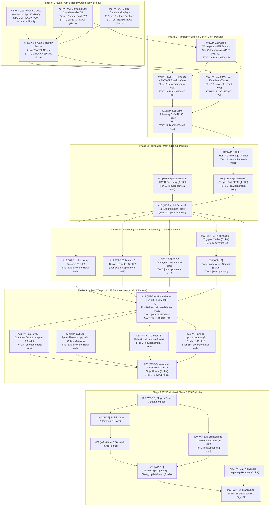

# Multi-Agent Task Roadmap, Dependency DAG & Unblocker Matrix

This document defines the end-to-end execution order, task/subtask dependency graph (`Blocked By` $\rightarrow$ `Unblocks`), parallel agent fan-out windows, and quantitative milestone exit gates across all **30 Work Packages (`GitHub Issues #4..#33`)** and **463 Atomic Translation Packets (`PKT-001..PKT-463`)**.

---

## 1. End-to-End Critical Path & Parallel Fan-Out DAG

---

## 2. What Can Be Assigned & Executed Right Now (Immediate Action Queue)

Crucial architectural observation: **Track A (Code & In-Memory C++ Golden Vector Generation)** and **Track B (Retail `.big` Asset & Replay Verification)** can start **simultaneously without waiting on each other**:

| Track | GitHub Issue | Assignee / Environment | Why It Can Start Immediately | What It Unblocks Next |
| :--- | :--- | :--- | :--- | :--- |
| **Track A (No `.big` files needed)** | **[`#5` (`WP-0.2`)](https://github.com/chayuto/generals-rust/issues/5)** | `Tier 3 (Architect)` (`env:local-full`) | `fbraz3/GeneralsX` (`84a7a20`) compiles 100% from public C++ source code without needing `~/Games/generalszh`. | 1. Running `scripts/prep_packet.py` (`Tier 0`) to slice all remaining 460 packets from `vendor/GeneralsX`. 2. Starting **[`#8` (`WP-1.1`)](https://github.com/chayuto/generals-rust/issues/8)** (Cargo workspace + C++ Golden Vectors for `PKT-001..003`, which are pure in-memory classes!). |
| **Track B1 (Public replay repo)** | **[`#6` (`WP-0.3` Part A)](https://github.com/chayuto/generals-rust/issues/6)** | `Tier 3 (Architect)` (`env:local-full`) | Cloning `generalsx-project/GeneralsXReplays` (6 cross-platform `.rep` files + custom maps) requires only `git`. | Prepares the replay directory for `#7` (`WP-0.4` Gate 0). |
| **Track B2 (Owner Steam login)** | **[`#4` (`WP-0.1`)](https://github.com/chayuto/generals-rust/issues/4)** | **Owner** + `Tier 3` (`env:local-full`) | Runs `steamcmd +@sSteamCmdForcePlatformType windows +force_install_dir ~/Games/generalszh +login <user> +app_update 2732960 validate +quit`. | Combined with `#5` and `#6`, immediately unblocks **[`#7` (`WP-0.4` Gate 0)](https://github.com/chayuto/generals-rust/issues/7)**. |

---

## 3. The 6 Master Unblockers (Choke Points & How They Unlock Parallel Swarm Work)

Because **83.6% of all packets (`387 / 463`)** are classified as `env:ephemeral-web` (can be executed by cheap, sandboxed web/cloud agents with codebase-only access), our primary job as `Tier 3 (Architect)` (`env:local-full`) is to clear **6 sequential unblocker choke points** that seed the FFI seams and C++ Golden Test Vectors:

| Unblocker ID | Choke-Point Issue(s) (`env:local-full`) | Exact Deliverable Required from `Tier 3` | Parallel Downstream Work Unlocked (`env:ephemeral-web`) |
| :--- | :--- | :--- | :--- |
| **Unblocker U1** | **`#5` (`WP-0.2`)** + **`#8` (`WP-1.1`)** | 1. Build `vendor/GeneralsX` (`84a7a20`). 2. Initialize Cargo workspace (`zh_common`, `zh_logic`, `zh_ffi`). 3. Generate & commit 1,000-seed C++ Golden Vectors (`tests/golden/PKT-001..003.json`). | Unlocks **`#9` (`WP-1.2a`)** and **`#10` (`WP-1.2b`)** for `Tier 1A` (`env:ephemeral-web`) workers to translate `crc`, `RandomValue`, and `ExperienceTracker` and verify **Gate V1 + Gate V2** in-sandbox. |
| **Unblocker U2** | **`#4` (`WP-0.1`)** + **`#6` (`WP-0.3`)** + **`#7` (`WP-0.4`)** | Run `GeneralsXZH -headless -replay "*.rep"` against `~/Games/generalszh` + `GeneralsXReplays`; commit `docs/BASELINE.md` (**Gate 0**). | Unlocks **Gate V3 (`shadow-verify`)** and **Gate V4 (6-Replay Corpus Matrix)** for `#9` and `#10`, leading directly to `#11` (`WP-1.3` Phase 1 Go/No-Go). |
| **Unblocker U3** | **`#11` (`WP-1.3`)** + Phase 2 Golden Vector Seed | Approve Phase 1 Spike Report (`docs/PHASE1_SPIKE_REPORT.md`); run `scripts/prep_packet.py` + C++ Golden Vector generator for Phase 2 (`Xfer`, `GameMath`, `NameKey`, `INI`). | Unlocks **Issues `#12`..`#15` (`WP-2.1`..`WP-2.4`, 24 core foundation packets)** for `Tier 1A` and `Tier 1B` agents, plus **Issue `#32` (`WP-7.2`, native `.big`/`.map`/`.rep` readers)**! |
| **Unblocker U4** | **Phase 2 Completion (`#12`..`#15`)** + Phase 3/4 Golden Vector Seed | Merge `XferCRC`, `GameMath`, `NameKeyGenerator`, and `INI` table scanners; commit C++ Golden Vectors for Phase 3 & 4 leaf classes. | Unlocks **21 parallel `env:ephemeral-web` packets in Phase 3 (`#16`..`#18`: `Money`, `Energy`, `ScoreKeeper`, `Science`, `Armor`, `Damage`, `WeaponBonus`, `TurretAI`, `Locomotor`)** AND **12 spatial packets in Phase 4 (`#19`..`#20`)**. |
| **Unblocker U5 (Largest Fan-Out)** | **`#21` (`WP-5.0`)** | Build `ModuleArena`, 64-bit `FacetMask`, `SimWorld::with_module_dispatch` (`Take-and-Restore`), C++ `RustBehaviorModuleAdapter` proxy, and C++ Golden Vector generator for all 222 `BehaviorModule` classes. | **MASSIVE SWARM UNLOCK:** Unlocks **221 independent module packets (`#22` `WP-5.1` [28 pkts], `#23` `WP-5.2` [64 pkts], `#24` `WP-5.3` [43 pkts], `#25` `WP-5.4` [86 pkts])** — **47.7% of the entire repository** — to run in parallel across `Tier 1A`, `Tier 1B`, and `Tier 2` `env:ephemeral-web` agents! |
| **Unblocker U6** | **`#26` (`WP-5.5`)** + **`#27` (`WP-6.1`)** | Move `Object` & `Weapon` into `ObjectArena` (`#26`) and `Player`/`Team` into `SimWorld` (`#27`); seed Golden Vectors for `ScriptConditions` & `ScriptActions`. | Unlocks **29 parallel script packets in `#30` (`WP-6.4`)** for `Tier 1A`/`Tier 2` `env:ephemeral-web` agents while `Tier 3` ports `Pathfinder` (`#28`), `AI` (`#29`), and `GameLogic::update()` (`#31`). |

---

## 4. Complete Work Package & Subtask Dependency Table (`Issues #4..#33`)

| Issue | Work Package | Phase | Tier | Environment | Packets | Status | Blocked By | Unblocks | Required V&V Gates |
| :--- | :--- | :--- | :--- | :--- | :---: | :--- | :--- | :--- | :--- |
| **[`#4`](https://github.com/chayuto/generals-rust/issues/4)** | **`WP-0.1`** Retail `.big` Data (`steamcmd` App `2732960`) | Phase 0 | `Tier 3` + Owner | `env:local-full` | — | **READY NOW** | *None* | `#7` (`WP-0.4`) | `.big` checksum & mount verification |
| **[`#5`](https://github.com/chayuto/generals-rust/issues/5)** | **`WP-0.2`** Build C++ `GeneralsXZH` at `84a7a20` | Phase 0 | `Tier 3` | `env:local-full` | — | **READY NOW** | *None* | `#7` (`WP-0.4`), `#8` (`WP-1.1`), Tier 0 Slicer | `z_generals` + `z_googletest` exit `0` |
| **[`#6`](https://github.com/chayuto/generals-rust/issues/6)** | **`WP-0.3`** Assemble `GeneralsXReplays` Corpus | Phase 0 | `Tier 3` | `env:local-full` | — | **READY NOW** *(Part A)* | *None* for public replays (`#4,#5` for custom) | `#7` (`WP-0.4`) | 6 cross-platform `.rep` files verified |
| **[`#7`](https://github.com/chayuto/generals-rust/issues/7)** | **`WP-0.4`** Gate 0 Replay Runner & `docs/BASELINE.md` | Phase 0 | `Tier 3` | `env:local-full` | — | `status:blocked-on-vv` | `#4`, `#5`, `#6` | `#9`, `#10` (Gates V3/V4) | **Gate 0** (100% C++ replay corpus pass) |
| **[`#8`](https://github.com/chayuto/generals-rust/issues/8)** | **`WP-1.1`** Cargo Workspace, FFI Seam & Gate V2 Harness | Phase 1 | `Tier 3` | `env:local-full` | `PKT-004` | `status:blocked-on-vv` | `#5` | `#9`, `#10` (Gates V1/V2) | C++ Golden Vectors generated + FFI link pass |
| **[`#9`](https://github.com/chayuto/generals-rust/issues/9)** | **`WP-1.2a`** Translate `crc.cpp` + `RandomValue.cpp` | Phase 1 | `Tier 1A` | `env:ephemeral-web` | `PKT-001`, `PKT-002` | `status:blocked-on-vv` | `#8` (for V1/V2), `#7` (for V3/V4) | `#11` | **Gates V1, V2, V3, V4** |
| **[`#10`](https://github.com/chayuto/generals-rust/issues/10)** | **`WP-1.2b`** Translate `ExperienceTracker.cpp` | Phase 1 | `Tier 1A` | `env:ephemeral-web` | `PKT-003` | `status:blocked-on-vv` | `#8` (for V1/V2), `#7` (for V3/V4) | `#11` | **Gates V1, V2, V3, V4** |
| **[`#11`](https://github.com/chayuto/generals-rust/issues/11)** | **`WP-1.3`** Phase 1 Telemetry & Go/No-Go Report | Phase 1 | `Tier 3` | `env:local-full` | — | `status:blocked-on-vv` | `#9`, `#10` | `#12`, `#13` (Phase 2) | Owner Go/No-Go Sign-Off |
| **[`#12`](https://github.com/chayuto/generals-rust/issues/12)** | **`WP-2.1`** `Xfer`, `XferCRC`, `XferDeepCRC`, `BitFlags<N>` | Phase 2 | `Tier 1A` | `env:ephemeral-web` | 4 core (`PKT-019..022`) | `status:blocked-on-vv` | `#11` + Phase 2 Golden Vectors | `#14`, `#15`, Phase 3–7 `Snapshot` impls | **Gates V1, V2, V3, V4** |
| **[`#13`](https://github.com/chayuto/generals-rust/issues/13)** | **`WP-2.2`** Deterministic `GameMath` & 2D/3D Geometry | Phase 2 | `Tier 1B` | `env:ephemeral-web` | 6 core (`PKT-005..015`) | `status:blocked-on-vv` | `#11` + Phase 2 Golden Vectors | `#15`, `#18`, `#19`, `#20`, `#28` | **Gates V1, V2, V3, V4** |
| **[`#14`](https://github.com/chayuto/generals-rust/issues/14)** | **`WP-2.3`** `NameKeyGenerator`, Strings, `Dict`, Base `StateMachine` | Phase 2 | `Tier 1B` | `env:ephemeral-web` | 4 core (`PKT-016..018, 023..029`) | `status:blocked-on-vv` | `#12` | `#15`, `#29`, `#30` | **Gates V1, V2, V3, V4** |
| **[`#15`](https://github.com/chayuto/generals-rust/issues/15)** | **`WP-2.4`** `INI` Parser & 28 Deterministic Scanners | Phase 2 | `Tier 1A` / `Tier 2` | `env:hybrid-ci` | 10+ (`PKT-030..099`) | `status:blocked-on-vv` | `#12`, `#13`, `#14` | `#16`..`#20` (All Phase 3 & 4), `#32` | **Gates V1, V2** (all `.big` INI corpus), **V3, V4** |
| **[`#16`](https://github.com/chayuto/generals-rust/issues/16)** | **`WP-3.1`** Economy Leaf Trackers (`Money`, `Energy`, `ScoreKeeper`, `Handicap`) | Phase 3 | `Tier 1A` | `env:ephemeral-web` | 6 (`PKT-100..108`) | `status:blocked-on-vv` | `#15` + Phase 3 Golden Vectors | `#21` (`WP-5.0`), `#27` (`WP-6.1`) | **Gates V1, V2, V3, V4** |
| **[`#17`](https://github.com/chayuto/generals-rust/issues/17)** | **`WP-3.2`** Tech Tree (`Science`, `RankInfo`, `Upgrade`, `SpecialPower`, `Prereq`) | Phase 3 | `Tier 1A` | `env:ephemeral-web` | 7 (`PKT-109..121`) | `status:blocked-on-vv` | `#15` + Phase 3 Golden Vectors | `#21` (`WP-5.0`), `#23` (`WP-5.2`), `#27` | **Gates V1, V2, V3, V4** |
| **[`#18`](https://github.com/chayuto/generals-rust/issues/18)** | **`WP-3.3`** Combat & Motion Leaf Models (`Armor`, `Damage`, `WeaponBonus`, `TurretAI`, `Locomotor`) | Phase 3 | `Tier 2` | `env:ephemeral-web` | 8 (`PKT-122..133`) | `status:blocked-on-vv` | `#13`, `#15` + Phase 3 Golden Vectors | `#21` (`WP-5.0`), `#22`, `#25`, `#26` | **Gates V1, V2, V3, V4** |
| **[`#19`](https://github.com/chayuto/generals-rust/issues/19)** | **`WP-4.1`** `TerrainLogic`, `PolygonTrigger`, `SidesList`, `CrateSystem`, `CaveSystem` | Phase 4 | `Tier 2` | `env:hybrid-ci` | 6 (`PKT-134..148`) | `status:blocked-on-vv` | `#13`, `#15` | `#20` (`WP-4.2`), `#21` (`WP-5.0`), `#30` | **Gates V1, V2, V3, V4** |
| **[`#20`](https://github.com/chayuto/generals-rust/issues/20)** | **`WP-4.2`** `PartitionManager`, `PartitionCell`, Shroud/Sight, `GhostObject` | Phase 4 | `Tier 3` | `env:hybrid-ci` | 6 (`PKT-149..157`) | `status:blocked-on-vv` | `#19` | `#21` (`WP-5.0`), `#26`, `#28` | **Gates V1, V2** (spatial tie-break fuzz), **V3, V4** |
| **[`#21`](https://github.com/chayuto/generals-rust/issues/21)** | **`WP-5.0`** `ModuleArena`, 64-Bit `FacetMask` & C++ `RustBehaviorModuleAdapter` Proxy | Phase 5 | `Tier 3` | `env:local-full` | Harness + Golden Gen | `status:blocked-on-vv` | `#16`, `#17`, `#18`, `#20` | **`#22`, `#23`, `#24`, `#25` (221 Modules!)** | Proxy no-op + 221 Golden Vector schemas pass |
| **[`#22`](https://github.com/chayuto/generals-rust/issues/22)** | **`WP-5.1`** Helpers (8), Destroy (1), Damage (3), Create (8) & Body (8) Modules | Phase 5 | `Tier 1A` | `env:ephemeral-web` | 28 (`PKT-158..193`) | `status:blocked-on-vv` | `#21` (`WP-5.0`) | `#26` (`WP-5.5`) | **Gates V1, V2, V3, V4** |
| **[`#23`](https://github.com/chayuto/generals-rust/issues/23)** | **`WP-5.2`** Die (12), SpecialPower (11), Upgrade (21) & Collide (20) Modules | Phase 5 | `Tier 1A` | `env:ephemeral-web` | 64 (`PKT-194..258`) | `status:blocked-on-vv` | `#21` (`WP-5.0`) | `#26` (`WP-5.5`) | **Gates V1, V2, V3, V4** |
| **[`#24`](https://github.com/chayuto/generals-rust/issues/24)** | **`WP-5.3`** Contain (13) & Multi-Facet Behavior (30) Modules | Phase 5 | `Tier 2` | `env:ephemeral-web` | 43 (`PKT-259..292`) | `status:blocked-on-vv` | `#21` (`WP-5.0`) | `#26` (`WP-5.5`) | **Gates V1, V2, V3, V4** |
| **[`#25`](https://github.com/chayuto/generals-rust/issues/25)** | **`WP-5.4`** All 86 `UpdateModule` Subclasses Across 5 Sub-Batches (`5.4a`–`5.4e`) | Phase 5 | `Tier 1B` | `env:ephemeral-web` | 86 (`PKT-293..378`) | `status:blocked-on-vv` | `#21` (`WP-5.0`) | `#26` (`WP-5.5`) | **Gates V1, V2** (SleepyUpdate return verification), **V3, V4** |
| **[`#26`](https://github.com/chayuto/generals-rust/issues/26)** | **`WP-5.5`** `Weapon`, `WeaponSet`, `ObjectCreationList` & `Object` Core in `ObjectArena` | Phase 5 | `Tier 3` | `env:hybrid-ci` | 8 (`PKT-379..386`) | `status:blocked-on-vv` | `#22`, `#23`, `#24`, `#25` | `#27` (`WP-6.1`), `#31` (`WP-7.1`) | **Gates V1, V2, V3, V4** |
| **[`#27`](https://github.com/chayuto/generals-rust/issues/27)** | **`WP-6.1`** `Player`, `PlayerList`, `Team`, `Squad`, `BuildAssistant`, `ActionManager` | Phase 6 | `Tier 3` | `env:hybrid-ci` | 9 (`PKT-387..397`) | `status:blocked-on-vv` | `#26` | `#28`, `#29`, `#30` | **Gates V1, V2, V3, V4** |
| **[`#28`](https://github.com/chayuto/generals-rust/issues/28)** | **`WP-6.2`** `Pathfinder` & `AIPathfind` | Phase 6 | `Tier 3` | `env:hybrid-ci` | 11 (`PKT-398..400`) | `status:blocked-on-vv` | `#20`, `#27` | `#29` (`WP-6.3`), `#31` | **Gates V1, V2** (A* tie-break & quantization), **V3, V4** |
| **[`#29`](https://github.com/chayuto/generals-rust/issues/29)** | **`WP-6.3`** `AI`, `AIGroup`, `AIPlayer`, `AISkirmishPlayer` & `AIStateMachine` | Phase 6 | `Tier 3` | `env:hybrid-ci` | 8 (`PKT-401..419`) | `status:blocked-on-vv` | `#27`, `#28` | `#31` (`WP-7.1`) | **Gates V1, V2, V3, V4** |
| **[`#30`](https://github.com/chayuto/generals-rust/issues/30)** | **`WP-6.4`** `ScriptEngine`, `ScriptConditions` (10 pkts), `ScriptActions` (15 pkts), `VictoryConditions` | Phase 6 | `Tier 2` | `env:ephemeral-web` | 29 (`PKT-420..448`) | `status:blocked-on-vv` | `#27` + Script Golden Vectors | `#31` (`WP-7.1`) | **Gates V1, V2, V3, V4** |
| **[`#31`](https://github.com/chayuto/generals-rust/issues/31)** | **`WP-7.1`** `GameLogic::update()`, `SleepyUpdateHeap`, 55 Command Dispatchers & `getCRC()` | Phase 7 | `Tier 3` | `env:hybrid-ci` | 8 (`PKT-449..456`) | `status:blocked-on-vv` | `#26`, `#28`, `#29`, `#30` | `#33` (`WP-7.3`) | **Gates V1, V2, V3, V4** (100% Rust `GameLogic::update()`) |
| **[`#32`](https://github.com/chayuto/generals-rust/issues/32)** | **`WP-7.2`** Native Pure-Rust `.big` Archive, `.map` Chunk, `.csf` & `.rep` Readers | Phase 7 | `Tier 2` | `env:hybrid-ci` | 5 (`PKT-457..461`) | `status:blocked-on-vv` | `#15` (`WP-2.4`) *(can run in parallel with Phases 3–6!)* | `#33` (`WP-7.3`) | Byte-exact VFS & `.rep` parse parity vs C++ |
| **[`#33`](https://github.com/chayuto/generals-rust/issues/33)** | **`WP-7.3`** Standalone Pure-Rust Headless Simulation Binary (`zh-sim`) & Stage 1 Benchmark | Phase 7 | `Tier 3` | `env:local-full` | 2 (`PKT-462..463`) | `status:blocked-on-vv` | `#31`, `#32` | **Stage 1 Complete** $\rightarrow$ Stage 2 Renderer | Zero C++ link dependency (`otool -L` / `ldd`) + 100% Replay Corpus CRC Match |

---

## 5. Key Project Milestones & Quantitative Exit Criteria

| Milestone | Git Tag Target | Scope (`Issues` / `Packets`) | Quantitative Verification Exit Gate |
| :--- | :---: | :--- | :--- |
| **M0 — Architecture & V&V Foundation** *(Done)* | `v0.0.0-arch` | 463-Packet Manifest, Gate V1 Linter, Tier 0 Slicer, 3-OS CI | **PASSED:** 100% of 833 C++ files mapped; 17/17 V&V self-tests passing on Linux, macOS, and Windows CI. |
| **M1 — Ground Truth & Replay Oracle (Phase 0)** | `v0.1.0-baseline` | Issues `#4`..`#7` (`WP-0.1`..`WP-0.4`) | `GeneralsXZH` built at `84a7a20` and passing **100% of the 6 cross-platform Zero Hour replays (`Gate 0`)** in `docs/BASELINE.md`. |
| **M2 — Translation Spike & Go/No-Go (Phase 1)** | `v0.2.0-spike` | Issues `#8`..`#11` (`PKT-001`..`PKT-004`) | `crc`, `RandomValue`, and `ExperienceTracker` translated by `Tier 1A` agents from Tier 0 packets; **1,000-seed Gate V2 + Gate V3/V4 replays 100% green**; Owner Go/No-Go sign-off on `docs/PHASE1_SPIKE_REPORT.md`. |
| **M3 — Deterministic Foundation & INI Parser (Phase 2)** | `v0.3.0-common` | Issues `#12`..`#15` (`PKT-005`..`PKT-099`, 95 packets) | Rust `XferCRC`, `GameMath`, `NameKeyGenerator`, and `INI` table scanners parse 100% of retail `.big` INI files with bit-exact `RulesRegistry` hashes and zero replay CRC drift. |
| **M4 — Domain Models & Spatial Engine (Phases 3 & 4)** | `v0.4.0-spatial` | Issues `#16`..`#20` (`PKT-100`..`PKT-157`, 58 packets) | Rust `Money`, `Energy`, `Science`, `Armor`, `Damage`, `Locomotor`, `TerrainLogic`, and `PartitionManager` running live across all 6 cross-platform replays with zero CRC drift. |
| **M5 — 222 BehaviorModules & `ObjectArena` (Phase 5)** | `v0.5.0-modules` | Issues `#21`..`#26` (`PKT-158`..`PKT-386`, 229 packets) | All 222 `BehaviorModule` subclasses + `Object` + `Weapon` running inside Rust `ModuleArena` / `ObjectArena` via `SimWorld::with_module_dispatch`, verified by Gates V1–V4. |
| **M6 — Player, Pathfinder, Skirmish AI & Scripts (Phase 6)** | `v0.6.0-ai-scripts` | Issues `#27`..`#30` (`PKT-387`..`PKT-448`, 62 packets) | Rust `Player`, `Team`, `Pathfinder`, `AIStateMachine`, and `ScriptEngine` (92 conditions + 320 actions) passing all skirmish & 6-player replays bit-exact. |
| **M7 — Stage 1 Standalone Headless Engine (`zh-sim`, Phase 7)** | `v1.0.0-stage1` | Issues `#31`..`#33` (`PKT-449`..`PKT-463`, 15 packets) | Standalone pure-Rust `zh-sim` binary links **zero C++ libraries**, reads `.big`/`.map`/`.rep` directly, runs at $\ge 1{,}000$ logic FPS headless, and matches 100% of C++ reference replay CRCs across macOS, Linux, and Windows. |
