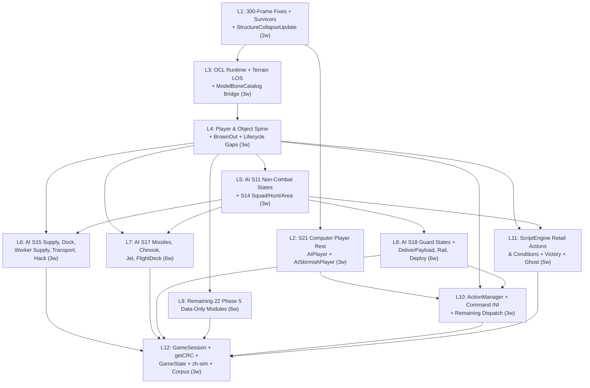

# Stage 1 Completion Plan: Headless Replay CRC Parity (`L1`–`L12`)

> **Milestone Target:** `v1.0.0-stage1` — standalone pure-Rust `zh-sim` binary (`crates/zh_sim`) executing full retail replays at 30 Hz and matching stock `GeneralsXZH` `GameLogic::getCRC()` at every checkpoint with zero C++ linked.
> **Parent Plan:** [FULL_PORT_PLAN.md](FULL_PORT_PLAN.md) | **AI Detail:** [AI_PORT_PLAN.md](AI_PORT_PLAN.md) | **Current Gaps:** [HANDOFF.md](HANDOFF.md), [OPEN_DECISIONS.md](OPEN_DECISIONS.md)

---

## 1. Honest Accounting of What Remains in Stage 1

[PORT_MAP.md](PORT_MAP.md) currently shows `463` manifest packets: `291` implemented, `36` data-only, and `136` unported. File existence alone both **overcounts** completed work (11 partial core packets) and **overcounts** remaining Stage 1 work (~97 non-Stage-1 packets):

| Category in `PORT_MAP.md` | Packets | Est. C++ LOC | Stage 1 Disposition |
|---|---:|---:|---|
| **C++-Only Runtime / Memory / Debug / Host Glue** | ~70 | ~24,000 | **Drop / Non-Goal for Rust:** `GameMemory*` (7), `CriticalSection`/`ScopedMutex`/`LatchRestore`/`WorkerProcess`/`SubsystemInterface`/`FunctionLexicon`/`STLTypedefs`/`List`/`AsciiString`/`UnicodeString`/`Debug`/`Errors`/`MiniLog`/`StackDump`/`PerfMetrics`/`PerfTimer`/`FPUControl`/`Registry`/`UpdateChecker`/`urllaunch`, `*Preferences` (8), `LocalFile*`/`Directory`/`WorkingDirectory`/`encrypt`/`StreamingArchiveFile` (replaced by `std::fs` + `zh_common::io`), `ObjectIter`/`SimpleObjectIterator`, `CommandLine`/`GameMain`/`FramePacer`/`FrameRateLimit`. |
| **Stage 2–5 Client / Audio / Client INI** | ~27 | ~13,500 | **Deferred to Stages 2–5:** `GameAudio`, `AudioEvent*`, `GameMusic`, `GameSounds`, `MiscAudio`, `DrawModule`, `ClientUpdateModule`, `GameLOD`, `Language`, client `INI*` scanners (covered in [CLIENT_ARCHITECTURE_PLAN.md](CLIENT_ARCHITECTURE_PLAN.md)). |
| **Subsumed / Header-Only Phase 5** | 4 | ~970 | `PKT-307` (`BaseRegenerateUpdate` -> `AutoHealBehavior`), `PKT-343` (`NeutronBlastBehavior` -> `EMPUpdate`), `PKT-364` (`SabotageFakeBuildingCrateCollide`), `PKT-385` (`UpdateModule` base trait). |
| **True Remaining Stage 1: Phase 5 (`36` data-only + `3` unported)** | 39 | ~39,700 | `36` modules in `WP-5.3`/`WP-5.4` + `POWTruckBehavior` + `PropagandaCenterBehavior` + `Object.cpp` (`PKT-390`, ~5,187 code LOC) + `ObjectCreationList::create` (`PKT-391`). |
| **True Remaining Stage 1: Partial Core Packets (`11`)** | 11 | ~24,000 | `PKT-216` (`FireWeaponPower`), `401` (`ActionManager`), `403` (`BuildAssistant`), `411` (`AIPathfind`), `421` (`AI`), `426` (`AIPlayer`), `427` (`AISkirmishPlayer`), `431`–`433` (`Scripts`), `440` (`GameLogic`). |
| **True Remaining Stage 1: Unported Phase 4/6/7 Logic** | 11 | ~10,400 | `AIDock`, `AIGuard`, `AIGuardRetaliate`, `AITNGuard`, `ResourceGatheringManager`, `VictoryConditions`, `GhostObject`, `GameState`/`GameStateMap`/`XferSave`/`XferLoad`/`XferCRC`, `ReplaySimulation`. |

*(Recommendation: add a `"disposition"` field to `MODULE_MANIFEST.json` or update `scripts/port_map.py` in `L12` so C++-only and Stage 2+ packets are separated cleanly from Stage 1 progress.)*

---

## 2. Production Game Loop Owner (`GameSession`) & `FrameSeams` Elimination

Today `crates/zh_logic/src/gamelogic/game_logic.rs` returns a loose `GameStart` bundle, `run_frame` in `crates/zh_logic/src/gamelogic/frame.rs` delegates 12 steps to `FrameSeams`, and `crates/zh_logic/tests/golden_game_frames.rs` wires those seams inside a test harness.

### 2.1 Target `GameSession` Struct (`crates/zh_logic/src/gamelogic/session.rs`)

```rust
pub struct GameSession {
    pub sim: SimContext,            // Owns RulesRegistry (w/ ModelBoneCatalog), SimWorld (w/ TerrainLogic & Pathfinder), ClientSink
    pub stores: StartupStores,
    pub sides: SidesList,
    pub players: PlayerList,
    pub teams: TeamFactory,
    pub scripts: GameScripts,
    pub commands: CommandState,
    pub victory: VictoryConditions,
    pub recorder: ReplayDriver,     // Replay queue, CRC verification log, live command buffer
    pub game: Option<GameOptions>,
    pub time_frozen: Bool,
}
```

### 2.2 16-Step `GameLogic::update()` Parity Map (`GameLogic.cpp` vs `frame.rs`)

| Step | C++ `GameLogic::update()` | Current Rust (`frame.rs`) | Eliminated By |
|---:|---|---|---|
| 1 | `tryStartNewGame()` if `m_startNewGame` | `start_new_game_observed` (standalone) | `L12` |
| 2 | `TheGameClient->setFrame(m_frame)` | Ignored (non-sim); forward via `ClientSink` in Stage 3 | `L12` / Stage 3 |
| 3 | `TheScriptEngine->UPDATE()` | `FrameSeams::script_engine` (wired in `golden_game_frames`) | `L11` + `L12` |
| 4 | `TheFramePacer->setTimeFrozen` + early return if frozen | `FrameSeams::is_time_frozen` | `L12` |
| 5 | `TheTerrainLogic->UPDATE()` (water levels, bridge damage-state flags) | `FrameSeams::terrain_logic` | `L12` |
| 6 | Replay/MP CRC calculation (`getCRC(CRC_RECALC)`) & `MSG_LOGIC_CRC` | Missing (game-wide CRC absent) | `L12` |
| 7 | `TheRecorder->UPDATE()` | `FrameSeams::recorder` | `L12` |
| 8 | `processCommandList(TheCommandList)` | `FrameSeams::command_list` (`command_target.rs` partial: 14 of ~100 cases) | `L10` + `L12` |
| 9 | Sleepy update loop (`m_sleepyUpdates`) | **Real:** `sim.step_sleepy_updates()` | Done (verify edge cases) |
| 10 | `TheAI->UPDATE()` (`Pathfinder::processPathfindQueue`) | **Real:** `process_path_queue(sim)` | Done |
| 11 | `ThePlayerList->UPDATE()` (`AIPlayer`, team scripts, power sabotage, upkeep) | Mixed: `expire_power_sabotage` real; `player_ai`, `team_generic_scripts`, `power_brown_out_change`, `player_upkeep` are seams | `L2` + `L4` + `L12` |
| 12 | `TheBuildAssistant->UPDATE()` (sell list) | `FrameSeams::build_assistant` | `L4` + `L12` |
| 13 | `ThePartitionManager->UPDATE()` | **Real:** `sim.update_partition()` | Done |
| 14 | `processDestroyList()` | **Real:** `sim.process_destroy_list()` (needs pathfind cleanup) | `L4` |
| 15 | `TheWeaponStore->UPDATE()` (delayed damage) + `TheVictoryConditions->UPDATE()` | `weapon_effects::update_delayed_damage` real; `weapon_store` + `victory_conditions` seams | `L11` + `L12` |
| 16 | `Object::checkDisabledStatus` loop + `m_frame++` | **Real:** `check_disabled_statuses(sim)` + `sim.world.frame.wrapping_add(1)` | Done |

---

## 3. Exact `GameLogic::getCRC()` Specification & Bisection Strategy

Verified directly from `GameLogic.cpp`, `Object.cpp`, `PartitionManager.cpp`, `PlayerList.cpp`, `Player.cpp`, `AI.cpp`, `AIPathfind.cpp`, and `AIGroup.cpp`:

### 3.1 Exact 5-Section Byte Stream

1. **`"MARKER:Objects"`** (`xfer_ascii_string`): iterate `m_objList` (newest-first!) -> `Object::crc(xfer)`:
   - `m_privateStatus` (`u8`)
   - `getTransformMatrix()` (`Matrix3D`, 48 raw bytes)
   - `m_id` (`u32`/`i32`, 4 bytes)
   - `m_objectUpgradesCompleted` (8 bytes `Int64` under `retail-crc`; full `UpgradeMaskType` otherwise)
   - `m_experienceTracker->crc(xfer)`
   - `getBodyModule()->getHealth()` (`f32`)
   - `m_weaponBonusCondition` (`u32`)
   - `getBodyModule()->getDamageScalar()` (`f32`)
   - `WEAPONSLOT_COUNT` (`3`) weapons via `xferSnapshot`
   - Module CRCs via `BehaviorModule::crc(xfer)` (crucially, `AIUpdateInterface::crc` delegates to its `xfer`, hashing its next wake frame — which `BehaviorModule::crc` must receive from `SleepyUpdateHeap`!).
2. **`GetGameLogicRandomSeedCRC()`** (`u32`, written only when `XferMode::Crc`).
3. **`"MARKER:ThePartitionManager"`**: `m_cells[0..total].crc(xfer)`.
4. **`"MARKER:ThePlayerList"`**: `m_playerCount` (`i32`) -> for each player `0..count`, `Player::crc`:
   - `battlePlanBonus: Bool` -> if true, `armorScalar`, `sightRangeScalar`, `bombardment`, `holdTheLine`, `searchAndDestroy`, `validKindOf`, `invalidKindOf`
   - `m_skillPoints` (`i32`), `m_sciencePurchasePoints` (`i32`).
5. **`"MARKER:TheAI"`**: `Pathfinder::crc` (`m_extent`, `m_isMapReady`, `m_isTunneling`, obsolete `0`, `m_ignoreObstacleID`, queued requests, cell CRC flags) -> `TAiData` chain (`"MARKER:TAiData"` + snapshot) -> `m_groupList` (`"MARKER:AIGroup"` + `AIGroup::crc`).

### 3.2 Checkpoint Cadence & Closing Gate 0

- **Trigger cadence:** In solo/solo-replay mode, `getCRC(CRC_RECALC)` runs every `REPLAY_CRC_INTERVAL = 100` frames; in multiplayer/MP-replay mode, every `TheGameInfo->getCRCInterval()` frames (skipping frame 0 when `RETAIL_COMPATIBLE_CRC` is enabled).
- **Section-Level Bisection Oracle (`L12`):** Add `--dump-crc-sections` to `zh-sim` and a matching C++ diagnostic oracle emitting `[frame, after_objects, seed, after_partition, after_playerlist, after_ai, total_crc]` (plus per-object CRCs on mismatch). That reduces any 10,000-frame replay mismatch to a single section, object ID, and frame in seconds without manual lldb stepping.
- **Closing Gate 0:** Keep the 6 public `GeneralsXReplays` command streams as regression stress streams ([BASELINE.md](BASELINE.md)), and record a clean **self-recorded Steam verification corpus** (8–12 replays generated by stock `GeneralsXZH` against `~/Games/generalszh` covering 2p/4p/6p skirmishes, USA/China/GLA + Generals variants, airfields, superweapons, tunnels, supply/workers, bridges, garrisoning, stealth/mines, and campaign/challenge scripts). Once `GeneralsXZH` passes 100% of that corpus and `zh-sim` matches every checkpoint CRC, **Gate 0 and Stage 1 both close cleanly**.

---

## 4. High-Impact Cross-Cutting Gaps (Ranked)

1. **Computer player remainder & 19-game position drift (`L1`, `L2`):** `computer.position` diverges in 19/24 games at frames 2–181; `AIPlayer`/`AISkirmishPlayer` unit training, team building, and defenses remain unported.
2. **`ObjectCreationList` runtime `create()` (`L3`):** `spawn_ocl` only logs names; debris, mines, parachutes, ambush spawns, artillery bursts, and `BoneFXUpdate` / `FireSpreadUpdate` OCL RNG draws are all missing.
3. **`MissileAIUpdate` unported (`L7`):** Weapons place non-`ProjectileUpdateInterface` missiles at destinations without detonation — **missiles never detonate**.
4. **No `ModelBoneCatalog` in `SimContext` (`L3`):** `crates/zh_assets/src/model.rs` already computes `PristineBones` and `barrels()`, but `SimContext` still sees `weapon_barrel_count = 0`, boneless dock positions, and empty `pristine_bones` (`SpawnPointProductionExitUpdate` refuses every reservation; [OPEN_DECISIONS.md](OPEN_DECISIONS.md) #9).
5. **Terrain line-of-sight always clear (`L3`):** `TerrainLogic::is_clear_line_of_sight` exists in `zh_logic::terrain` but is not wired into weapons, targeting, or partition sight checks.
6. **`Player` & `Object` spine gaps (`L4`):** Per-team stand-in maps for sciences/timers/handicaps/bans, missing `Player::onPowerBrownOutChange`, missing `Player::xfer`, and `Object` lifecycle gaps (`onCapture`, `defect`, `initObject` battle-plan bonuses, `updateWeaponSet`, `setStatus(UNDER_CONSTRUCTION)` mine detonation, pathfind unit removal on destroy/contain).
7. **Supply/Dock/Worker economy AI (`L6`):** `SupplyTruckAIUpdate`, `AIDock`, and the Worker's supply half are unported, blocking real skirmish economies.
8. **`ActionManager` permissions & `GameLogicDispatch` remainder (`L10`):** `world.action_permissions` is a test stand-in (`PKT-401` is 109 Rust LOC vs 1,491 C++ LOC); `command_target.rs` covers 14 of ~100 `GameLogicDispatch.cpp` cases (plus `CommandTarget` covers rally/production/powers/sell — ~20 gameplay commands remain unported).
9. **Retail-used `ScriptEngine` actions & conditions (`L11`):** Per `docs/SCRIPT_USAGE_COUNTS.json`, `38/82` retail-used conditions (87.5% of uses) and `51/262` retail-used actions (61.8% of uses) are ported. Remaining hot items (`PLAYER_HAS_COMPARISON_UNIT_TYPE_IN_TRIGGER_AREA` 496 uses, `SKIRMISH_SPECIAL_POWER_READY` 483, `TEAM_GUARD_AREA` 1060, `TEAM_HUNT` 1046, `CREATE_UNNAMED_ON_TEAM_AT_WAYPOINT` 926, `TEAM_FOLLOW_WAYPOINTS` 900, `CREATE_REINFORCEMENT_TEAM` 842) block skirmish and mission scripts.
10. **No `GameSession`, no `GameLogic::getCRC()`, no `zh-sim` (`L12`):** Frame execution lives in a test harness and nothing computes the 5-section game CRC.

---

## 5. Dependency-Ordered Completion Slices (`L1`–`L12`)



*Note on parallel waves:* After `L1`–`L4` complete, `L5`, `L6`, `L7`, `L9`, and parts of `L11` run across 3–5 parallel disjoint worktrees per coordinator wave (`<= 1,400` C++ LOC per worker).

| Slice | Scope & Packet / C++ Targets | Rust Targets | Est. Workers | Required Oracles & Exit Criteria |
|---|---|---|---:|---|
| **L1** | Investigate & fix 19-game computer position drift, `linux_2p_vanilla_map` frame-185 human dozer move, `tournament_city` `-pi`/`+pi`; port `StructureCollapseUpdate` (`PKT-376`, ~381 code LOC); recheck mutation survivors (`BoneFXUpdate`, `Science`, `BuildAssistant`, `Turrets`) | `ai_player.rs`, `dozer_ai_update.rs`, `structure_collapse_update.rs` | 2 | `gen_wp54` collapse oracle (`-O0`/`-O2`/sanitizers), `mutate_check`, `golden_game_frames` ratchet strictly improves |
| **L2** | Complete S21 (`PKT-426` `AIPlayer`, `PKT-427` `AISkirmishPlayer`, ~2.5k remaining): team building, `queueUnits`/`queueDozer`/supply trucks, `BUILD_TEAM`, `startTraining`, `findFactory`, recruiting, `onUnitProduced`/`onStructureProduced`, rebuild holes, bridge repair, defenses, upgrades, superweapons | `ai/ai_player.rs`, `ai/ai_skirmish_player.rs`, `modules/update/ai_update/dozer.rs` | 2–3 | Multi-minute C++ AI trace vectors + `golden_game_frames` computer count/position/AI jump |
| **L3** | (a) `ObjectCreationList` runtime `ObjectCreationNugget::create` (`PKT-391`, ~1.2k remaining); (b) Wire `TerrainLogic::is_clear_line_of_sight` + cliff/path checks into weapons, targeting & `find_position_around`; (c) Wire `zh_assets::model` into `RulesRegistry::model_bones` (`ModelBoneCatalog`: barrels, launch offsets, dock/spawn bones) | `object/object_creation_list.rs`, `object/weapon_*.rs`, `sim/mod.rs`, `gamelogic/game_engine.rs` | 3 | `gen_ocl` 1,000-seed oracle; terrain LOS trace; retail `.w3d` bone catalog test (`SpawnPointProductionExitUpdate` + weapon barrels real) |
| **L4** | Move team-keyed stand-ins (`sciences`, `radar`, `handicaps`, `build_bans`, `special_power_timers`, `cost/time modifiers`) into `Player` (`PKT-404`); `Player::onPowerBrownOutChange` + `Player::xfer`/`crc`; `Object` lifecycle gaps (`PKT-390` remainder: `onCapture`, `defect` mines, `initObject` battle plans, `updateWeaponSet`, `setStatus(UNDER_CONSTRUCTION)`, `remove_unit_from_pathfind_map` on destroy & contain) | `player/player.rs`, `player/player_list.rs`, `player/team.rs`, `object/object.rs`, `sim/mod.rs` | 3 | `gen_player_state` full `Player::xfer`/`crc` oracle + `gen_object_lifecycle` differential vectors |
| **L5** | AI S11 non-combat states (`waypoint follow`, `wander`, `panic`, `repulsors`, `dock`, `enter`, `exit`, `evacuate`, `face`, `wait`, `rappel`, `crate pickup`; ~1.6k) + S14 remainder (`squad`, `hunt`, `attack_area`, turret `transferAttack`) | `ai/ai_states/{noncombat,attack}.rs`, `ai/squad.rs`, `modules/update/ai_update/` | 3 | Trace oracle per state + `golden_s11` / `golden_s14` parity + `AiSeams` override cleanup |
| **L6** | AI S15: `SupplyTruckAIUpdate` (`PKT-380`, 777 code), `AIDock` (`PKT-422`, ~750), `TransportAIUpdate` (`PKT-384`, 204), `HackInternetAIUpdate` (`PKT-332`, 566), `ResourceGatheringManager` (`PKT-407`, ~250), Worker supply machine, `PrisonDockUpdate` (`PKT-353`, 104), `RailedTransportDockUpdate` (`PKT-361`, 359) | `ai/ai_dock.rs`, `player/resource_gathering_manager.rs`, `modules/update/{supply_truck_ai_update,transport_ai_update,hack_internet_ai_update,worker_ai_update,prison_dock_update,railed_transport_dock_update}.rs` | 3 | Live supply-gather + hack-internet + prison/rail dock C++ traces (money, boxes, wake frames, CRC) |
| **L7** | AI S17 (6 single-class workers): `MissileAIUpdate` (`PKT-340`, 807 code — **unlocks missile detonation**), `NeutronMissileUpdate` + `NeutronMissileSlowDeathUpdate` (`PKT-345`+`344`, 954), `ChinookAIUpdate` (`PKT-312`, 1,382), `JetAIUpdate` Part 1 & 2 (`PKT-337`, 2,376 + `ParkingPlaceBehavior` integration), `FlightDeckBehavior` (`PKT-270`, 1,473) | `modules/update/{missile_ai_update,neutron_missile_update,neutron_missile_slow_death_update,chinook_ai_update,jet_ai_update}.rs`, `modules/behavior/flight_deck_behavior.rs` | 6 | Separate trace oracles per aircraft/missile family comparing 3D pos/orient bits, ammo, payload, detonation, and AI save bytes |
| **L8** | AI S18: `AIGuard` (`PKT-424`), `AIGuardRetaliate` (`PKT-425`), `AITNGuard` (`PKT-430`) [3 workers]; `DeliverPayloadAIUpdate` (`PKT-317`, 1,129), `RailroadGuideAIUpdate` + `RailedTransportAIUpdate` (`PKT-362`+`360`, 1,525), `DeployStyleAIUpdate` + `AssaultTransportAIUpdate` + `WanderAIUpdate` + `POWTruckAIUpdate` + `POWTruckBehavior` (`PKT-319`+`303`+`386`+`352`+`288`, ~1,470) [3 workers] | `ai/{ai_guard,ai_guard_retaliate,aitn_guard}.rs`, `modules/update/*`, `modules/behavior/pow_truck_behavior.rs` | 6 | Trace oracles for guard radius/chase/tunnel, paradrop/payload runs, train carriages, deploy/wander |
| **L9** | Remaining 22 Phase 5 modules in 3 disjoint waves: (a) Contain/Combat (`OverlordContain`, `RiderChangeContain`, `RebuildHoleBehavior`, `CountermeasuresBehavior`, `HijackerUpdate`, `PilotFindVehicleUpdate`, `DemoTrapUpdate`, `StickyBombUpdate`); (b) Superweapons/Lasers (`ParticleUplinkCannonUpdate`, `SpectreGunshipUpdate`, `EMPUpdate`, `LaserUpdate`, `FirestormDynamicGeometryInfoUpdate`, `WaveGuideUpdate`); (c) Support (`MobMemberSlavedUpdate`, `CleanupHazardUpdate`, `FireOCLAfterWeaponCooldownUpdate`, `PropagandaCenterBehavior`, `CheckpointUpdate`, `EnemyNearUpdate`, `AnimationSteeringUpdate`) + mark subsumed `PKT-307/343/364/385` | `modules/{behavior,contain,update}/*.rs`, `docs/MODULE_MANIFEST.json` | 6 | 1,000-seed `build_oracle.py` differential tests (`-O0`/`-O2`/sanitizers) + `mutate_check.py` per wave |
| **L10** | S19 `ActionManager` (`PKT-401`, ~1.1k remaining), full `CommandButton` + `CommandSet` INI parsing (`PKT-091`/`092`, replacing hardcoded `command_store`), and S20 remaining `GameLogicDispatch` messages (rally points, `DOZER_CONSTRUCT_LINE`, `DOZER_CANCEL_CONSTRUCT`, beacons, surrender/self-destruct, retaliation, POW pickup, replay camera, `FIRE_WEAPON_POWER` `PKT-216` fix) | `player/action_manager.rs`, `rules/command_{button,set}.rs`, `gamelogic/{game_engine,command_target}.rs`, `modules/special_power/fire_weapon_power.rs` | 3 | `gen_action_manager` + extended `gen_pkt044_dispatch` + retail `CommandButton`/`CommandSet` load check |
| **L11** | Complete retail-used `ScriptEngine` (`PKT-431`–`433`, driven by `SCRIPT_USAGE_COUNTS.json`: remaining 44 used conditions + top ~150 retail sim actions + `ClientSink` events for audio/camera/UI triggers), `VictoryConditions` (`PKT-435`), `GhostObject` (`PKT-158`), `BorderColors` (`PKT-402`) | `scripts/{script_engine,script_conditions,script_actions,script_world,victory_conditions}.rs`, `spatial/ghost_object.rs`, `player/border_colors.rs` | 5–6 | `gen_scripts` differential vectors + full skirmish/campaign `.scb`/map script regression tests |
| **L12** | Build `GameSession` (`gamelogic/session.rs`, removing `FrameSeams`), full 5-section `GameLogic::getCRC()`, `GameState`/`GameStateMap` save/load (`WP-2.1`), `crates/zh_sim` CLI (`zh-sim`), clean self-recorded local replay corpus (closing **Gate 0**), full-corpus CRC bisection sweep & `PORT_MAP.md` disposition cleanup | `crates/zh_sim/`, `gamelogic/{session,game_logic,replay_simulation}.rs`, `zh_common/src/xfer/`, `scripts/port_map.py` | 3 | **Gate 0 + Gate V4:** `zh-sim` matches stock `GeneralsXZH` `getCRC()` at 100% of checkpoints on all local replays; `cargo test --workspace` + `x86_64` pass |

**Stage 1 Total Remaining Estimate:** ~44–49 worker slices (~15–24M tokens at empirically observed 300k–500k tokens/slice), executable across ~8–10 parallelized coordinator waves.

---

## 6. Mandatory Verification Checkpoints per Merge

Every slice merged into `main` must pass all gates from [WORKER_BRIEF.md](WORKER_BRIEF.md) and [HANDOFF.md](HANDOFF.md):
1. **Oracle consistency:** C++ harness built with `--opt O0`, `--opt O2`, and `--opt O2 --sanitize` producing byte-identical vectors; floats compared as raw `u32` bits.
2. **Mutation kill rate:** `python3 scripts/mutate_check.py golden_<name> <new .rs> diff:<changed>` with survivors tracked/resolved.
3. **Determinism & cross-arch parity:** `python3 scripts/lint_determinism.py`, `cargo test --workspace` (`arm64` locally, `x86_64` in CI), and `-p zh_logic --features retail-crc` + `retail-xfer-save`.
4. **Ratchet & Vendor integrity:** `golden_game_frames` never regresses without documented coincidence cause; `python3 scripts/check_vendor.py`, `port_map.py --check`, `gen_engine_sim.py --check`, `validate_manifest.py`, and `scripts/test_*.py` all exit `0`.
